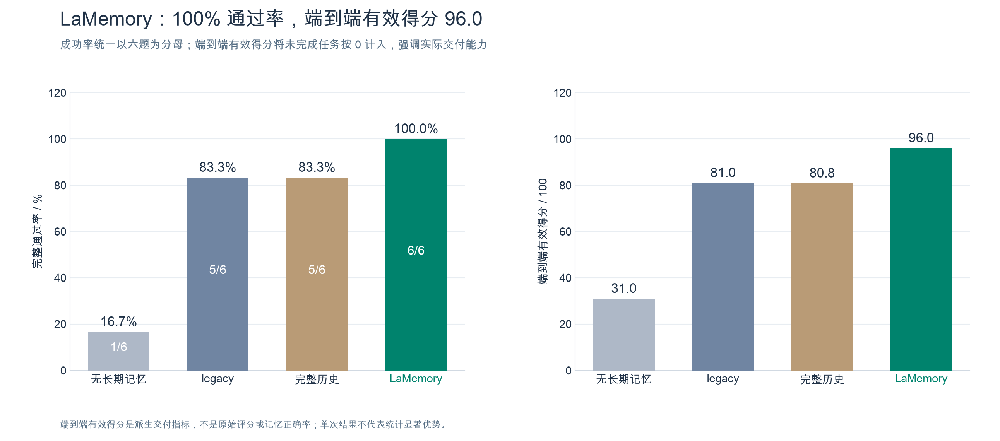
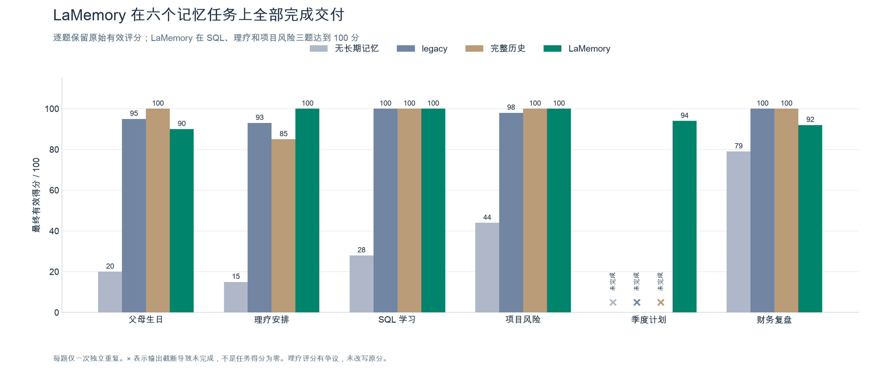
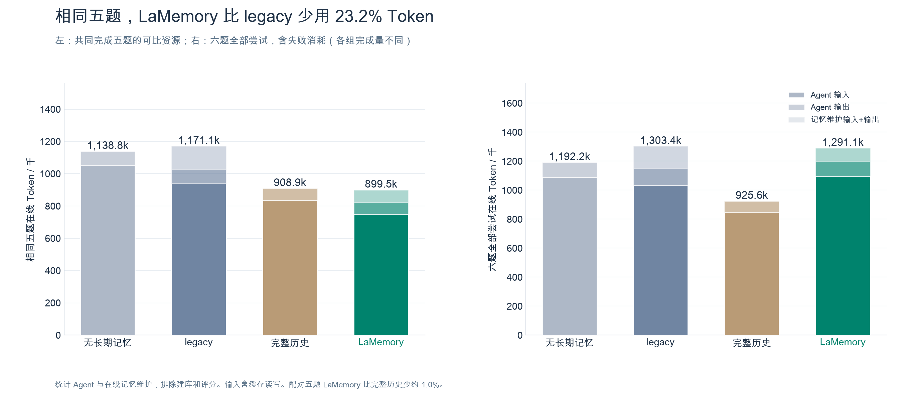
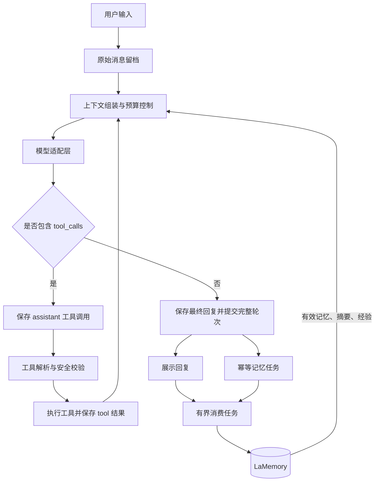

# myClaude

一个用 Python 实现的 LLM Agent 实验项目，重点探索 **Agent loop 如何运行**，以及 **记忆如何在多轮、跨会话交互中保持可追溯和一致**。

项目将模型调用、工具执行、消息留档、上下文组装与长期记忆拆成可阅读、可替换的模块。核心设计围绕两条链路展开：

- **执行闭环**：构造上下文 → 调用模型 → 执行工具 → 回传结果 → 继续推理，直到生成最终回复。
- **记忆闭环**：保存原始证据 → 提取结构化记录 → 聚合分层摘要 → 按需召回 → 根据更正、遗忘和反馈更新状态。

记忆系统命名为 **Layered Aggregated Memory（LaMemory）**。当前已实现 M0–M3 的单机运行时，使用 SQLite 持久化，默认关键词检索，可显式配置混合召回与可选重排。已完成真实聊天模型与 embedding 服务参与的记忆任务对照，结果如下。

## 记忆任务评测

2026-11-12，使用 DeepSeek `deepseek-flash` 与 `Qwen/Qwen3-Embedding-4B`，在生日提醒、理疗安排、SQL 学习、项目风险、季度计划、财务复盘六个任务上比较四种方法：无长期记忆（`none`）、全量注入提取后 Markdown 的旧系统（`legacy`）、完整历史用户原文（`full_history`）和 **LaMemory**。每题一次独立重复、三轮固定对话，使用相同模型、工具和预算。

- **完整通过六题（6/6，100%）**，是本轮唯一全部通过的方法；六题最终有效均分为 **96.0**。
- 在四组共同完成的五题上，相比 legacy，在线 **Token 减少 23.2%**、**费用降低 35.3%**，原评分均分为 **96.4 对 97.2**。
- 六题首轮第一次请求的平均上下文相比完整历史 **减少 42.2%**；此项为运行器估算，不能直接等同于整项任务的 Token 或费用节省。

### 完整交付与通过率



通过要求三轮执行与评分全部成功，且最终达到该题阈值。图中的端到端有效得分以六题为分母，未完成任务按 0 计，是交付指标，不表示其已有产物或记忆质量得分为零。

### 六个任务的实际得分



LaMemory 在理疗、SQL、项目风险三题取得 100 分，并完成了其他三组因输出截断而未完成的季度计划。图中保留原始评分；理疗题存在通勤缓冲的评分争议，具体产物与敏感性分析见完整报告。

### Token 消耗与资源效率



左图只比较四组共同完成的同一五题，统计 Agent 与在线记忆维护的输入、输出 Token，包含缓存读写，排除建库与评分；右图保留六题全部尝试的消耗。LaMemory 完成了更多任务，不能把其他组失败早停的低消耗视为效率优势。完整历史组在配对五题上的费用仍更低，当前结果不表示 LaMemory 在所有指标上均最优。

本次仅汇总六个记忆任务，不包含通用编程任务。每题只有一次独立重复，三轮复查不等于三个独立样本，尚不能据此宣称统计显著优势或经验迁移收益。

[完整报告、费用与全部图表](docs/lamemory-memory-task-results-20261112/README.md) · [评测协议](docs/lamemory-benchmark-protocol.md) · [运行与复现](benchmarks/memory_benchmark/README.md)

## 整体结构



Agent 每次调用模型时使用受预算约束的工作上下文，原始消息和工具结果则独立留档。历史裁剪、摘要生成和检索选择都基于这份证据构建视图。

## Agent loop：从消息到行动

### 循环与状态推进

终端入口在 [`Agent/chatBot_with_memory/main.py`](Agent/chatBot_with_memory/main.py) 中通过 `Node / Flow` 表达循环：

```python
chat = ChatNode()
tool_call = ToolCallNode()
output = OutputNode()

chat - "tool_call" >> tool_call
tool_call - "chat" >> chat
tool_call - "output" >> output
chat - "output" >> output
```

`ChatNode` 负责组装上下文、调用模型并保存 assistant 消息；`ToolCallNode` 执行工具、保存结果，再将控制权交回模型；没有工具调用时进入 `OutputNode` 展示回复并有界处理记忆任务。

[`core/node.py`](core/node.py) 提供同步的 action 路由：节点返回 `(action, payload)`，`Flow` 根据 action 选择后继节点。路由允许回边，因此可以表达工具循环和失败回退。节点仅对 `RetryableError` 做指数退避，耗尽后走配置的回退或错误路径；其他异常直接抛出。

[`ChatRunner`](Agent/chatBot_with_memory/runner.py) 提供独立于终端 UI 和全局 `shared` 的运行入口，用于 Web 工作台、嵌入和隔离 smoke：

- 通过实例注入记忆服务、模型调用函数和工具集合。
- `send()` 限制模型调用轮数，检查截止时间与取消信号。
- 通过事件回调输出消息、上下文诊断和工具执行轨迹，记录模型 usage。
- 默认只注册绑定当前身份的记忆工具，普通工具由宿主显式传入。

当前工具按顺序同步执行。Runner 的截止时间在调用边界检查，模型请求会收到剩余时间；宿主添加的同步工具需要自行遵守超时。

### 工具调用是消息协议的一部分

[`ToolExecutor`](tools/executor.py) 将模型返回的工具调用解析为统一结构，经过 [`SafetyGuard`](tools/guard.py) 检查后执行，再将结果转换为带 `tool_call_id` 的 `tool` 消息。

执行链路保留以下约束：

1. **先记录调用，再执行工具**：assistant 工具调用保存失败时停止本轮工具执行。
2. **结果与调用对应**：工具结果携带原调用 ID；未知工具、拦截、拒绝及执行异常均返回可回传的错误结果。
3. **上下文保留完整工具链**：按完整轮次裁剪历史，检查调用与结果的对应关系；超长工具结果可生成有限视图，原文继续留档。
4. **持久化失败可观察**：最终回复保存失败会报告本轮未完整保存；工具结果留档失败会中止后续循环。

安全策略在 [`tools/safety_policy.yaml`](tools/safety_policy.yaml) 中配置，分为 `blocked / confirm / pass`。终端模式对需确认操作请求用户输入；无人值守 Runner 返回“未执行”。这层校验用于工具执行前的策略检查，运行环境隔离由宿主负责。

### 模型协议在边界适配

[`core/providers/`](core/providers/) 统一处理供应商配置、消息转换、工具协议、错误和用量；Agent loop 使用统一的消息与工具结构。当前支持 OpenAI Chat Completions、Anthropic 原生 Messages，以及 DeepSeek、Qwen 和自定义 OpenAI 兼容接口。

主对话与记忆任务可使用不同模型，也可注入本地替代实现进行验证。配置方式和协议覆盖范围见 [模型提供商适配层](docs/model-providers.md)。

## LaMemory：从原始证据到可复用记忆

### 分层存储与职责

[`LaMemoryService`](core/lamemory/service.py) 绑定用户、会话与可选项目，统一管理写入、检索、上下文和维护任务。各层通过来源关系关联：

| 层次 | 保存内容 | 作用 |
|---|---|---|
| 原始证据 | user / assistant / tool 消息、完整工具结构、轮次 | 恢复会话，追溯事实与执行过程 |
| 结构化记忆 | 事实、偏好、事件、范围、时间、状态与版本 | 跨会话检索、精确更正与遗忘 |
| 聚合摘要 | 用户概览、项目摘要、手动主题摘要及来源版本 | 提供背景与主题导航，控制上下文体积 |
| 程序经验 | 任务类型、适用条件、步骤、结果依据与反馈 | 在证据验证后复用任务经验 |

SQLite 是当前持久化存储，数据表使用 `lamemory_` 前缀。默认数据库为项目内 `.myclaude/lamemory/lamemory.sqlite3`，已加入 Git 忽略。[`core/memory.py`](core/memory.py) 保留旧 `Memory` 接口，内部委托给 LaMemory。

完整的数据表关系、记忆生成、更正、遗忘与召回链路见 [LaMemory 存储结构与记忆生命周期](docs/lamemory-storage-and-lifecycle.md)。

关键词与语义向量双路召回、RRF 融合及可选重排序的设计见 [LaMemory 混合召回代码构建方案](docs/lamemory-hybrid-retrieval-plan.md)。

上述方案已完成本地实现与离线集成，真实 hybrid 任务验证见上方评测。启动、回填、模型示例、早期验证状态及回退方式见 [混合召回实施与验证](docs/lamemory-hybrid-retrieval.md)。原方案保留为实施前设计。

### 写入：完整轮次驱动，显式操作即时返回

自动提取与主动管理共用同一个服务：

```text
append_message(user)
  → append_message(assistant tool_calls)
  → append_message(tool results)
  → append_message(assistant final)
  → commit_turn()
  → 持久化提取任务
  → process_pending() / flush()
```

`append_message()` 只保存原文；`commit_turn()` 校验最终回复与完整工具链，在同一事务中提交轮次并创建幂等任务。重复提交不会重复提取，任务创建也不依赖模型是否返回 usage。

终端在主回复展示后至多处理一个任务。独立 Runner 只提交任务，由宿主安排后续消费；服务本身不会自动启动后台 worker。提取失败保留错误和重试状态，可通过维护接口检查、重试或等待完成。

用户明确要求记住、更正或忘记时，模型可调用 `lamemory_store`、`lamemory_search`、`lamemory_update` 和 `lamemory_forget`。工具绑定当前身份和来源，写入结果区分 `saved`、`duplicate`、`conflict`、`suppressed`；冲突待裁决或被抑制的内容不能报告为已生效。

### 一致性：来源、版本与失效传播

LaMemory 的管理规则围绕“信息来自哪里、现在是否有效”展开：

- **范围隔离**：用户级记忆跨会话共享，session 记忆限定原会话，项目事实与经验限定绑定的项目；按 ID 查看和操作同样检查归属。
- **更正留痕**：更新创建新版本并保留替代关系，默认检索使用有效记录；待裁决冲突保留供检查。
- **遗忘防重放**：遗忘使记忆失效，并抑制从旧来源再次提取。原始会话留档继续保留，删除原文需要单独流程。
- **摘要随来源失效**：来源新增、更正、遗忘或补充时，在写事务中将相关摘要标脏并投递重建任务。脏摘要暂停注入，重建发布前复核来源版本与哈希。
- **失败可恢复**：任务持久化，支持有限重试和重启后继续处理；`flush()` 跟踪相关任务及消费期间新增的摘要任务，明确返回完成、失败或超时。

首次调用 `refresh_summaries()` 或 `consolidate()` 可建立用户概览及配置项目的固定摘要，`define_topic()` 管理手动主题。未提供分层摘要模型时使用有长度限制的原文摘录。接口与维护流程见 [M2/M3 开发交付](docs/lamemory-m2-m3.md)。

### 读取：按需召回与上下文预算

默认检索模式为 `keyword`，先按身份、范围、状态和时间过滤，再匹配排序。`hybrid` 增加真实 embedding、按种类 RRF 和可选重排；返回实际模式、来源与覆盖率/降级诊断。当前请求作为召回依据，只缓存查询向量，每次重新读取并复核有效候选，评分诊断不占注入预算。

[`context.py`](core/lamemory/integration/context.py) 将有效事实、相关主题、用户概览、已验证经验和近期对话组装为模型输入，统一约束预算：

```text
允许输入 = 模型窗口 − 输出预留 − 安全余量
实际输入 = 系统提示 + 工具 schema + 历史/工作摘要 + 当前轮次 + 召回记忆
```

召回内容另受 `memory_token_budget` 限制。超预算时依次减少召回内容、移除旧的完整轮次、舍弃工作摘要，再截短工具结果视图；仍无法容纳当前轮次时抛出 `BudgetError`。Token 数使用保守估算，诊断会标明计量方式、输入预算、选中记忆、丢弃轮次和工具视图裁剪情况。

召回内容在上下文中明确标注为历史参考数据。工作摘要由 `compress()` 显式触发，原始证据继续保留。

### 程序经验：候选经过反馈验证后复用

经验学习默认关闭，可通过 `auto_learn_experiences=True` 或终端 `--learn-experiences` 启用候选提取，也可由宿主手动提交：

```text
完成任务 → 提取 candidate → 独立用户/测试反馈 → active → 检索与复用
                                                ↓ 失败反馈
                                             revoked
```

默认需要两个独立任务的成功证据，或用户明确认可，才能晋升为有效经验。模型自评仅留档，训练轨迹与重复反馈不累加独立成功次数；用户或测试失败反馈会撤销有效经验，替代版本重新从候选验证。提交测试证据和用户认可由可信宿主负责，模型工具只提供搜索、查看和撤销等受限操作。

## 快速开始

需要 Python ≥ 3.13，推荐使用 uv。在项目根目录执行：

```bash
uv sync
cp .env.example .env
```

在 `.env` 中填写实际可用的供应商、模型 ID 和密钥；自定义兼容服务同时配置完整 API base URL：

```dotenv
LLM_PROVIDER=openai-compatible
LLM_MODEL_NAME=your-model-id
LLM_API_KEY=your-api-key
LLM_BASE_URL=https://your-provider.example/v1
LLM_CONTEXT_WINDOW=32768
LLM_MAX_TOKENS=4096
```

`MEMORY_LLM_*` 可独立配置记忆提取与摘要模型，未填写时共用主模型。完整变量见 [`.env.example`](.env.example)。

```bash
# 启动终端对话；留空 --session 时创建新会话
uv run python -m Agent.chatBot_with_memory.main --user local-user

# 将 session-example 替换为终端打印的会话 ID，恢复历史
uv run python -m Agent.chatBot_with_memory.main --user local-user --session session-example

# Web 工作台：http://127.0.0.1:3080
uv run python -m Agent.chatBot_with_memory.web
```

可使用 `--database /absolute/path/memory.sqlite3` 隔离数据，使用 `--project <project-id>` 绑定项目。记忆维护、迁移预览与旧数据导入见 [LaMemory 使用与验证](docs/lamemory-usage.md)，Web 配置见 [工作台使用说明](docs/chat-web.md)。

## 代码阅读入口

```text
myClaude/
├── core/
│   ├── node.py                 # Node / Flow：同步路由、重试、回退
│   ├── llm.py                  # 模型调用兼容入口
│   ├── providers/              # 配置、供应商适配、消息与工具协议
│   ├── memory.py               # 旧 Memory 接口兼容门面
│   └── lamemory/
│       ├── service.py          # 记忆生命周期与持久化任务
│       ├── store.py            # SQLite 存储与版本迁移
│       ├── extraction.py       # 提取结果校验
│       ├── retrieval.py        # 关键词检索与排序
│       ├── context.py          # 上下文预算与工具链完整性
│       ├── hierarchy.py        # 分层摘要及来源失效传播
│       ├── consolidation.py    # 精确去重与整理
│       ├── procedural.py       # 经验候选、反馈、晋升与撤销
│       └── tools.py            # 绑定身份的主动记忆工具
├── tools/                      # 工具定义、执行器、安全策略、Skill 加载
├── Agent/chatBot_with_memory/
│   ├── main.py                 # Node / Flow 终端循环
│   ├── runner.py               # 可注入、带事件回调的独立循环
│   └── web.py                  # Web 交互入口
├── tests/                      # 记忆行为、协议与集成回归
├── benchmarks/                 # 隔离 smoke 与验证证据
└── docs/                       # 架构、开发指南和使用说明
```


