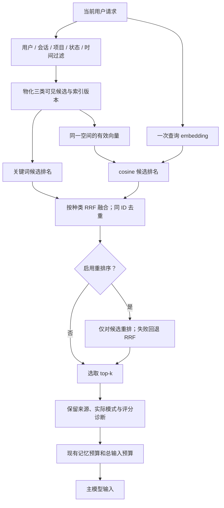

# LaMemory 混合召回代码构建方案

日期：2026-11-10。核对基线：Git `7d29ffd`。本文是**待实现的工程方案与实施交接说明**，不是已完成功能或评测报告。另一个终端开始实施时，应先读取当前 `AGENTS.md`、检查 HEAD 与工作区，按实际代码调整文件位置，不覆盖其他终端的改动。

目标：为 LaMemory 增加 **关键词召回 + 语义向量召回 → RRF 融合与去重 → 可选重排序**，接入现有服务、主动工具、终端、Web 与上下文预算。

## 1. 范围与已确定的工程决策

| 项目 | 本轮决策 |
|---|---|
| 召回对象 | 结构化记忆 `item`、有效主题摘要 `summary`、已验证程序经验 `experience` |
| 用户概览 | 保留现有背景导航逻辑，单独返回；不靠人为构造关键词分数参与 RRF |
| 关键词分支 | 复用现有 `normalized / terms / rank`；本轮不顺带更换 BM25 或 SQLite FTS |
| 向量分支 | 真实 embedding + cosine similarity；SQLite 存向量，Python 精确计算相似度 |
| 候选融合 | 按对象种类分别执行加权 RRF，默认两路等权 |
| 去重 | 同一 `(entity_kind, entity_id)` 合并多路命中；保留全部通道证据 |
| 重排序 | 默认关闭；提供可注入协议及一个可运行的 LLM JSON 重排适配器 |
| 新增外部基础设施 | 首版不要求独立向量数据库，也不要求 GPU/本地大型模型 |
| 数据权威来源 | 既有消息、记忆、摘要与经验表；向量只是可重建的检索投影 |
| 索引更新 | 持久化、串行、有界的独立索引任务；业务写入事务内不调用外部模型 |
| 兼容默认 | `LaMemoryConfig.retrieval_mode` 继续默认 `keyword`；显式设置 `hybrid` 启用新链路 |
| 故障策略 | 运行时 embedding 失败可降级关键词；重排失败回退 RRF；必须报告实际模式和原因 |
| 本轮不实现 | 图检索、自动主题聚类、语义合并事实、ANN、多 worker、自动选择模型 |

三类对象共用检索引擎，但分别保留候选排名、top-k 和返回类型。这样不引入“经验天然比事实更重要”的全局排序假设，也不在本轮重写现有层级预算策略。原始消息与会话工作摘要不纳入向量索引。

## 2. 当前代码基线与必须改的入口

| 当前文件 | 当前行为 | 计划变化 |
|---|---|---|
| `core/lamemory/config.py` | 只允许 `keyword` | 支持 hybrid 及算法配置；模型凭据另放实例配置 |
| `core/lamemory/retrieval.py` | 中文双字片段/英文词，按覆盖率打分 | 保留关键词纯函数，增加独立 cosine/RRF 纯函数或转调新模块 |
| `core/lamemory/service.py` | `search()` 取有效项后关键词排序 | 接入统一 `retrieve()`；保留旧返回类型 |
| `core/lamemory/hierarchy.py` | 关键词主题 + profile 导航 | 分离“取有效候选”与“排序”；hybrid 主题走统一引擎 |
| `core/lamemory/procedural.py` | active 经验拼文本关键词排序 | 分离候选读取；hybrid 经验走统一引擎 |
| `core/lamemory/models.py` | `SearchHit` 只有单分数/理由/mode | 增加可选检索元数据及通用内部返回对象 |
| `core/lamemory/context.py` | 检索诊断写死 `keyword` | 使用真实检索诊断；不把完整评分元数据塞进提示词 |
| `core/lamemory/tools.py` | 工具结果和描述写死关键词 | 报告实际模式、降级、排名证据；身份绑定不变 |
| `core/lamemory/__main__.py` | CLI 搜索结果 mode 写死关键词 | 配置入口、索引命令、诊断与明确退出码 |
| `core/memory.py` | 兼容门面构造服务 | 支持注入 embedder/reranker，并明确客户端所有权 |
| `Agent/chatBot_with_memory/main.py` | 回复后消费一个长期记忆任务 | 通过统一工厂注入检索依赖，增加有界索引维护 |
| `Agent/chatBot_with_memory/runner.py` | 只提交任务；上下文可观察 | 继续由宿主消费任务，传递新诊断，不增加隐式后台线程 |
| `Agent/chatBot_with_memory/web.py` | 不同请求创建服务；记忆搜索只返回 item | 每条路径注入相同检索配置；搜索详情能报告实际模式 |

注意两个容易遗漏的实现细节：`PRAGMA data_version` 不会因同一连接的提交而增加；程序经验反馈可能改变状态但不改变 `revision`。因此不能只拿这两者判断缓存或向量有效性。

## 3. 总体链路



核心顺序固定：**先按权限与有效状态过滤，再召回，再融合，再重排，再截取最终 top-k，最后预算打包**。不能先全库取向量 top-k 再过滤；不能让重排器添加新记忆或恢复失效记录。

## 4. 模块拆分与接口契约

建议新增以下模块，保持现有 `core/lamemory/` 目录，不引入其他记忆系统的代码或专属接口。

```text
core/lamemory/
├── retrieval.py                 # 现有关键词纯函数，保持行为兼容
├── retrieval_types.py           # 文档、通道命中、bundle、诊断类型
├── retrieval_engine.py          # 候选过滤后的混合召回编排
├── retrieval_sources.py         # 三类对象的候选读取与文本物化
├── fusion.py                    # cosine、RRF、候选身份去重
├── embeddings.py                # EmbeddingConfig / 协议 / SDK 适配器
├── embedding_index.py           # 投影读写、任务、CAS 发布、覆盖率
├── reranking.py                 # Reranker 协议 / LLM 适配器 / 校验
├── runtime.py                   # 环境配置与宿主共用的依赖构造工厂
└── migrations/004_hybrid_retrieval.sql
```

若实施时已有 `004`，新增下一版本，不能改写已发布迁移。模块可在实现中适度合并，但权限过滤、纯排序函数和外部 provider 调用应有明确边界。

### 4.1 文档与通道返回对象

```python
@dataclass(frozen=True)
class RetrievalDocument:
    entity_kind: str       # item / summary / experience
    entity_id: str
    user_id: str
    scope_kind: str
    scope_key: str
    entity_generation: int
    revision: int
    text: str             # 实际索引文本，不包含原始消息全文
    input_hash: str       # 实际 embedding 输入的 SHA-256
    payload: dict         # 返回对象所需字段，provider 不接收此整包对象

@dataclass(frozen=True)
class ChannelHit:
    entity_kind: str
    entity_id: str
    channel: str          # keyword / semantic
    raw_score: float
    rank: int             # 从 1 开始；通道内同一对象只出现一次

@dataclass
class RetrievalBundle:
    items: list           # list[SearchHit]，兼容已有公开接口
    summaries: list[dict]
    experiences: list[dict]
    diagnostics: dict
```

`SearchHit` 原有 `item / score / reason / mode` 保留，增加 `retrieval: dict = field(default_factory=dict)`。摘要/经验结果保留原字段，并添加同结构的 `retrieval`。评分字段含义必须明确：

- keyword 正常结果或降级：`score_kind="keyword"`，`score` 为原关键词分数。
- hybrid 未重排：`score_kind="rrf"`，`score` 为 RRF 分数。
- hybrid 重排成功：`score_kind="rerank"`，`score` 为重排分数；原 `rrf_score` 仍保留。
- 分数均不是正确率或可信度，不跨不同算法/对象种类直接比较。

### 4.2 服务接口兼容

```python
LaMemoryService(
    config=None, *, user_id="local-user", session_id=None, provider=None,
    embedding_provider=None, reranker=None,
)

retrieve(query, *, kinds=("item", "summary", "experience"),
         filters=None, top_k=None) -> RetrievalBundle

# 现有调用者不必改返回类型
search(query, filters=None, top_k=None) -> list[SearchHit]
search_summaries(query) -> list[dict]
search_experiences(query, top_k=None) -> list[dict]

# 新增独立索引维护接口
enqueue_embeddings() -> dict
process_embedding_jobs(max_jobs=16, *, deadline=None) -> list[dict]
flush_embeddings(timeout=30) -> dict
embedding_status() -> dict
retry_embedding_job(job_id) -> bool
```

`filters` 只应用于 item；若 kinds 不含 item 且传入非空 filters，应报参数错误。包装接口只检索其需要的种类。`build_context()` 和 `lamemory_search` 调用一次三类 `retrieve()`，共享一次 query embedding，不能内部依次调用三次 provider。

避免用可被下一次搜索覆盖的 `last_search_diagnostics` 作为跨函数传参手段；诊断随 bundle 返回。兼容接口只取相应列表，新调用者可直接使用 bundle。

### 4.3 Provider 协议

```python
class EmbeddingProvider(Protocol):
    # 描述包含 model / dimensions / space_id，内容由宿主配置
    descriptor: EmbeddingDescriptor
    def embed_documents(self, texts: list[str], *, timeout: float) -> list[list[float]]: ...
    def embed_query(self, text: str, *, timeout: float) -> list[float]: ...

class Reranker(Protocol):
    fingerprint: str
    def rerank(self, query: str, documents: list[dict], *, timeout: float) -> list[dict]: ...
```

`embed_documents` 与 `embed_query` 分开，便于后续接入需要不同查询/文档前缀的模型；前缀配置进入空间指纹。服务层只依赖协议，不依赖具体 SDK。

Provider 必须执行传入超时，默认关闭 SDK 内部重试；不使用“启动线程后 join 超时”的方式假装取消仍在运行的模型调用。内部构造的客户端由服务/工厂关闭，外部注入的共享客户端由调用方管理，避免 Web 请求结束时关闭共享资源。

## 5. 配置与真实模型适配

### 5.1 算法配置

建议在 `LaMemoryConfig` 增加以下字段；数值是初始工程值，需用本项目样本校准。

| 字段 | 建议默认值 | 约束/含义 |
|---|---|---|
| `retrieval_mode` | `"keyword"` | 允许 `keyword/hybrid`；暂不增加纯 semantic 模式 |
| `keyword_candidate_k` | `30` | 关键词通道候选宽度，1–100 |
| `semantic_candidate_k` | `30` | 向量通道候选宽度，1–100 |
| `rrf_k` | `60` | 正整数，RRF 排名平滑常数，与 top_k 不同 |
| `keyword_weight` | `1.0` | 正有限数 |
| `semantic_weight` | `1.0` | 正有限数 |
| `semantic_min_similarity` | `0.3` | cosine 阈值，[-1,1]；暂定值，不是通用质量门槛 |
| `retrieval_timeout_seconds` | `10` | 一次 bundle 的 query embedding + 重排共享期限 |
| `allow_keyword_fallback` | `True` | 运行时向量通道异常是否允许降级 |
| `rerank_enabled` | `False` | 本轮只允许在 hybrid 模式开启 |
| `rerank_top_n` | `20` | 每类对象参与重排的 RRF 前缀，1–100 |
| `rerank_timeout_seconds` | `5` | 不超过检索剩余期限 |
| `embedding_batch_size` | `16` | 索引批处理大小；限制正整数和合理上限 |
| `max_embedding_chars` | `12000` | 文档向量输入的确定性字符上限 |

有效候选宽度为 `max(配置通道宽度, 本次 top_k)`，最大 100，解决 Web 的 `top_k=100` 被默认 30 限制的问题；重排前缀同理取 `max(rerank_top_n, top_k)`，最大 100。top_k 继续允许 0–100；0、空白查询或无有效候选应提前返回，不调用模型。

不要把语义分数阈值用于 RRF 分数。若以后允许语义阈值为 null，必须说明将失去该路的最低相关性截断；本轮建议先保留数值阈值并单独评测无答案查询。

### 5.2 独立模型配置

新增 `EmbeddingConfig`，不复用聊天 `ModelConfig` 的 max_tokens、reasoning 等字段：

```text
provider: openai-compatible（首个适配器类型）
model: 必填，不自动选择
base_url: 必填，显式指定，末尾 API base 路径按服务要求提供
api_key: 可选；需要鉴权的服务缺少密钥则配置错误
dimensions: 必填正整数，预期输出维度
send_dimensions: false，模型明确支持时才向 API 发送 dimensions
namespace: 必填，部署/权重/预处理版本标签
query_prefix / document_prefix: 默认空字符串
timeout / max_retries: 默认 10 / 0
```

`namespace` 用来显式区分同名模型的不同部署与权重；模型、维度、端点指纹、namespace、前缀、文本模板版本、截断上限或归一化策略改变，均生成不同 `space_id`。密钥不参与空间 ID，也不写入表、配置哈希或日志。

建议新增 `.env.example` 示例，仅放占位符：

```dotenv
LAMEMORY_RETRIEVAL_MODE=hybrid
LAMEMORY_EMBEDDING_PROVIDER=openai-compatible
LAMEMORY_EMBEDDING_MODEL=your-embedding-model
LAMEMORY_EMBEDDING_BASE_URL=https://your-embedding-endpoint.example/v1
LAMEMORY_EMBEDDING_DIMENSIONS=1024
LAMEMORY_EMBEDDING_NAMESPACE=deployment-v1
LAMEMORY_EMBEDDING_API_KEY=
LAMEMORY_EMBEDDING_SEND_DIMENSIONS=false
LAMEMORY_RERANK_ENABLED=false
# 开启 LLM 重排时提供独立完整配置，不隐式复用主聊天模型。
# LAMEMORY_RERANK_LLM_PROVIDER=openai-compatible
# LAMEMORY_RERANK_LLM_MODEL_NAME=your-rerank-chat-model
# LAMEMORY_RERANK_LLM_BASE_URL=...
# LAMEMORY_RERANK_LLM_API_KEY=
```

1024 仅是配置格式示例，必须按实际模型输出修改。`LaMemoryConfig` 本身不读环境；`runtime.py` 显式接收 env 映射、构造配置和依赖。hybrid 缺少完整 embedding 配置，或开启重排却未提供 reranker，属于启动配置错误；不能悄悄伪装为已启用。

### 5.3 Embedding 适配器实现要求

首个真实适配器复用已有 `openai` SDK 依赖，调用 `client.embeddings.create(model=..., input=[...], encoding_format="float")`；只在配置允许时传 `dimensions`。批量响应必须按 `data[].index` 还原输入顺序，检查索引完整、无重复、数量一致，不能假定服务按请求顺序返回。

每个向量检查：维度一致、元素为有限数值、不是 bool、非零范数。归一化后再存储；坏响应整体失败，不用空向量或随机向量补位。记录 embedding 文档/查询用量与耗时，与事实提取、主模型、重排成本分别计量。

上述请求参数与响应结构依据 [OpenAI 官方 embeddings API 文档](https://developers.openai.com/api/reference/resources/embeddings/methods/create)。兼容服务是否支持相同字段仍需单独验证，不能推定所有聊天供应商都提供 embedding。字符截断不等于模型 token 上限校验；超限应记录明确错误，按所选服务能力另加输入限制，不静默二次截断。

## 6. 向量存储与失效设计

### 6.1 新迁移的数据结构

建议新增 6 张投影/控制表。以下给出字段契约；最终 SQL 必须添加 CHECK、复合外键和查询索引，并通过旧库迁移测试。

| 表 | 主键与字段 | 用途 |
|---|---|---|
| `lamemory_retrieval_state` | `user_id PK, generation INTEGER` | 用户级单调递增变更计数，供同连接/跨连接缓存失效 |
| `lamemory_embedding_entities` | PK `(user_id, entity_kind, entity_id)`；`scope_kind, scope_key, generation, is_deleted, updated_at` | 持久化对象变更账本与范围快照；实体删除后保留 tombstone |
| `lamemory_embedding_spaces` | `space_id PK`；`descriptor_json, dimensions, created_at` | 无密钥的模型空间描述；防混用维度和预处理 |
| `lamemory_embeddings` | PK `(user_id, entity_kind, entity_id, space_id)`；`entity_generation, input_hash, dimensions, vector_blob, created_at` | 当前空间下该对象的最新向量投影 |
| `lamemory_embedding_jobs` | `job_id PK`；`user_id, entity_kind, entity_id, space_id, entity_generation, input_hash, status, attempts, available_at, last_error, created_at, updated_at` | 独立持久化索引任务；唯一键为对象+空间+generation |
| `lamemory_embedding_progress` | PK `(user_id, entity_kind, entity_id, space_id)`；`handled_generation, updated_at` | 记录已处理的代次，包括不可索引/已删除实体，避免反复清理 |

约束：entity_kind 仅允许 item/summary/experience；账本 scope_kind 仅允许 user/session/project，is_deleted 为 0/1；任务状态仅允许 pending/completed/failed/obsolete。embeddings、jobs、progress 通过 `(user_id, entity_kind, entity_id)` 外键关联账本，通过 `space_id` 外键关联空间表；向量内容长度必须与 float32 维度匹配。为任务调度建立 `(user_id, space_id, status, available_at)` 索引。

统一用显式 little-endian float32 BLOB，例如 `struct.pack('<...f', ...)`，不用 pickle，不依赖宿主字节序。读取时复核字节长度、有限数值和范数；损坏条目跳过并报告，不影响其他正常候选。

多态账本与权威表之间没有单个通用外键；查询和发布必须重新读取相应权威表，不能因为账本或向量存在就认定实体仍有效。

### 6.2 变更捕获必须在业务写事务内完成

在新迁移里给以下表添加 INSERT/UPDATE/DELETE 触发器：

- `lamemory_items`：新增、更正旧状态、遗忘、整理、slot 等字段变化。
- `lamemory_summaries`：dirty/generation 变化、摘要发布、定义变化。
- `lamemory_experiences`：候选、晋升、反馈计数、撤销、替代。

触发器对 OLD/NEW 所属对象 upsert 账本并增加对象 generation，同时增加用户级 `lamemory_retrieval_state.generation`。INSERT/UPDATE 更新范围快照并设置 is_deleted=0，DELETE 保存 OLD 范围并设置 is_deleted=1；摘要范围由 project_id 映射为 project 或 user。主键/归属字段按不可变身份处理；若允许直接 SQL 改身份，要同时使 OLD 和 NEW 键失效。外层事务回滚时，账本与计数也一起回滚。

迁移为现存对象初始化账本；不在迁移中调用模型。触发器只记变更，不生成空间相关任务，不写原始对话。这使 keyword 模式下的改动也能在以后启用 hybrid 时被追踪。

既有 `lamemory_sources` 变更通过现有层级触发器使相关摘要变脏；item 来源和经验反馈来源在返回时从权威关系读取，不保存在向量缓存中。对直接 SQL 修改 summary_sources/topic_items 的异常情况，继续执行现有摘要来源签名复核，不依赖账本替代它。

### 6.3 文本物化与索引有效性

| 对象 | 可索引条件 | 文本模板 |
|---|---|---|
| item | 当前可见且 active | `content`，不附上其他用户消息或工具日志 |
| summary | kind=topic、当前可见、dirty=0、非空、来源签名有效 | 固定标签 + `topic_key` + `content` |
| experience | 当前可见且 active | 固定标签 + task_type + conditions + steps + result_basis |

经验向量使用 result_basis 是相对当前关键词路径的明确新增；keyword 默认仍保留当前“任务类型+条件+步骤”的评分输入，以便单独判断语义分支收益。

文本先按固定模板物化，再加文档前缀并按配置上限确定性截断，最后计算实际输入哈希。空间描述包含模板和截断版本。报告被截断数量；超长经验尾部可能无法向量匹配，这是首版单向量方案的限制，不能声称已经实现分块召回。

使用投影时必须同时满足：权威对象仍可见且有效、账本 generation 等于向量记录 generation、space_id 完全匹配、维度正确、实际输入哈希一致。摘要额外复核来源签名。过滤完成后才能参与该路 top-k。

**关键一致性保证**：更正、遗忘、dirty 或经验撤销提交后，旧投影即使还在库中也立即失去资格；等待重建期间只少召回，不可继续使用旧事实。禁止用“向量还没来得及删除”解释旧记忆重新进入上下文。

## 7. 索引生成、重试与存量回填

### 7.1 调度与消费

```text
业务事务提交，账本 generation 改变
  → enqueue_embeddings() 对当前可见范围做差量协调
  → 读取可索引对象、物化文本，创建唯一空间+代次任务
  → process_embedding_jobs() 读取任务及最新来源快照
  → 无写事务调用真实 embed_documents()
  → 验证整批向量
  → 短事务复核来源/generation/hash/状态
  → 发布向量、更新 progress、标记完成
```

索引维护沿用当前单进程串行约束。索引任务独立于 `lamemory_jobs`，不伪造维护 session/turn，也不要求别的会话沿用原 project 才能索引用户级记忆；仍只能处理当前服务有权访问的对象。

具体规则：

1. `enqueue_embeddings()` 只处理当前用户可见的 user、当前 session、当前 project 记录。任务与状态统计不得暴露其他用户/项目的对象 ID。
2. 存量回填和新增记录共用同一流程；没有当前有效向量、progress 落后或投影损坏时可创建任务。任务唯一键保证重复协调不重复排队。
3. 对已删除/失效且先前可见的对象，清理对应投影、将旧 pending 任务标 obsolete，并更新处理代次。若已物理删除，按账本保留的 OLD scope 安全清理；不要因权威行缺失而把其他范围的任务当作当前任务。账本范围只用于任务归属，不能替代当前权威表的召回权限检查。
4. 旧 generation 任务不调用 provider，标 obsolete。失败任务保留 attempts/error，不因每次协调而重新置 pending。
5. metadata 变化而实际输入未变时，可以在相同用户、同实体、同空间内复用旧向量并更新代次；发布仍需通过 CAS 校验。不跨用户共享内容哈希缓存。
6. batch 内响应错误、数量不符或某向量非法时，本次批量结果不发布。响应结构合法后，发布事务中分别跳过已过期对象，其他仍有效对象可一起提交；数据库失败时本次发布整体回滚。
7. 网络失败最多尝试 3 次，沿用 0.1 秒起步的指数退避；配置可复用现有 job 重试参数。错误按类别留档并脱敏，不保存响应中的密钥或原始请求头。
8. CAS 复核失败的旧任务变 obsolete，协调器为新代次排队；不把旧向量挂到新版本上。
9. 同一代次的 completed 任务对应投影意外丢失/损坏时，协调器允许对该任务执行明确的 repair 复位，并记录原因；failed 必须显式 retry，不自动无限重试。

`max_jobs` 限制处理的实体任务数，`embedding_batch_size` 限制单请求文档数；传入 deadline 后每次请求使用剩余时间。不能因为分成多个 batch 就让一次维护无限延长。

### 7.2 flush 的边界

保留现有 `flush()` 对事实/摘要/经验生成任务的语义，不擅自把索引失败算作原始记忆保存失败。新增 `flush_embeddings()` 等待当前用户可见范围、当前空间的索引工作，并在期限内追踪来源变化造成的新代次。

其返回至少包含 `status=complete/failed/timeout`、completed、failed、remaining、obsolete、eligible、indexed、missing、space_id。只有当前可见、可索引对象全部有有效投影且没有目标失败/积压时，才返回 complete。无有效对象时可以 complete，但应明确 `eligible=0`。

需要“自动提取和全部索引都可检索”时，调用顺序是：

```python
generation_result = memory.flush(timeout=30)
if generation_result.status != "complete":
    # 报告生成任务失败/积压，不能宣称记忆已全部就绪。
    ...
index_result = memory.flush_embeddings(timeout=30)
```

`process_pending()` 不隐式消费索引任务；`flush_embeddings()` 不隐式完成未生成的事实或脏摘要。CLI 和文档必须说明二者区别。

### 7.3 查询不负责构建文档索引

`search()/retrieve()/build_context()` 不能在读取阶段为缺失文档批量补 embedding，以免一次查询触发全库模型费用。查询只生成一次 query embedding，查已有有效投影；缺失部分通过诊断和维护接口解决。

索引覆盖率基于过滤后的对象数统计，不是全库向量行数。`indexed=0` 时无需调用 query embedding，按策略降级或抛可处理错误；部分覆盖时可正常融合，但应报告 `partial_index=true` 和分种类覆盖率。

## 8. 检索算法的精确定义

### 8.1 三类候选的权限与有效性

复用现有 `_visible()` 等规则，抽成共享的候选读取函数，禁止复制出三套逐渐不一致的身份判断。

- item：保留现有 type/scope/time 过滤；默认 active。显式请求 pending/deleted/superseded 时，按历史查询走关键词路径，报告 `semantic_skipped_reason="historical_status"`，不为历史版本建立有效向量。
- topic：当前用户，项目匹配，dirty=0，正文非空，来源签名复核通过。用户主题不能通过成员关系读出项目私有数据。
- experience：当前用户，user 或当前 project，status=active。candidate/revoked/superseded 均不得参与。
- profile：沿用现有有效性检查及导航性质，作为背景候选附加，分数类型标 `background`；与 topic 一起仍受原 summaries top-k 及预算约束。主题优先，profile 占用剩余名额，不能无条件多塞一条绕过限制。

同一个查询的文档快照在 provider 调用之后必须再检查：状态改变、来源签名变化或 generation 改变的候选不得返回。允许在剩余期限内整体重试一次；再变化时过滤掉过期候选并报告 `sources_changed`，不无限重试。

### 8.2 关键词分支

keyword 模式完整保留当前召回行为、排序和返回状态。hybrid 的关键词分支只把截断位置从最终 top-k 扩大为通道候选宽度，再进行融合。

不能为了让新模式看起来更好而同时更换关键词分词或评分算法。未来 BM25/FTS 作为独立变更评测。

### 8.3 向量分支

```text
cosine(q, d) = dot(q, d) / (norm(q) × norm(d))
```

同一 query vector 复用于三类对象。读取 float32 后可重新归一化或显式保留范数计算，不能把量化后向量精确单位化当成不需验证的假设。结果截断到 [-1,1]，先过滤低于 `semantic_min_similarity` 的项，再按 cosine 降序、revision 降序、entity_id 排序，取通道候选宽度。

首版复杂度约为 O(N×D)，N 是当前身份/范围/状态过滤后的有效向量数。用批量 SQL 取投影，避免每个候选单查来源；最终入选后再加载完整来源。报告候选扫描数与耗时，数据规模增长后再根据测量决定是否替换 ANN 后端。

扫描按有界批次检查检索 deadline，CPU 计算也计入总期限；超时按语义通道故障处理。不能悄悄只扫描前若干向量，再把局部排序报告为完整精确召回。

### 8.4 加权 RRF

对同一种类的候选集合执行：

```text
rrf_score(d) = Σ[channel contains d] weight[channel] / (rrf_k + rank[channel, d])
```

排名从 1 开始；某路没有命中则该路贡献为 0。不相加 BM25/关键词覆盖率与 cosine 原始分数，不把未命中项硬填为“最后一名”。

例：`rrf_k=60`，两路权重都是 1：

```text
keyword: A, B, C
semantic: B, D, A

B = 1/62 + 1/61 ≈ 0.032522
A = 1/61 + 1/63 ≈ 0.032266
D =        1/62 ≈ 0.016129
C = 1/63        ≈ 0.015873

融合结果：B, A, D, C
```

规则必须可重复：每路先按实体身份去重并重新编号，避免重复项贡献多次分数；融合后每个身份只有一条。RRF 同分按最优通道名次升序、revision 降序、entity_id 升序打破平局。

语义通道正常执行但无结果，不属于故障；此时仍可给关键词候选 RRF 分数，报告 semantic_count=0。若语义通道异常且实际降级，则返回原关键词排序与分数，不能把失败请求伪装成正常 hybrid。

### 8.5 去重边界

本轮“融合与去重”专指**检索身份去重**，不修改权威记录：

- 两路命中同一对象：保留一条，记录两路 rank/raw_score 与各自 RRF 贡献。
- 同一条目有多个来源：来源 ID 集合化，但完整来源仍可 inspect。
- 内容相同但 ID 不同：不在检索时自动合并，尤其不同日期/未知时间事件必须保留；持久化精确去重继续由既有 `store()/consolidate()` 负责。
- topic 摘要覆盖某条事实：不因此丢弃该事实证据，二者不是同一个对象；由预算约束体积。
- 不做语义近似合并，不把“同一 slot 的旧版本”作为可见候选补入。

## 9. 可选重排序

### 9.1 开关与适配器

`rerank_enabled=False` 时不构造、不请求、不收费；只返回 RRF 排序。开启后对每类对象的 RRF 前 N 项评分，超出 N 的候选保留原 RRF 尾部。最终排序为“重排后的前缀 + 原尾部”，然后取 top-k；N 至少覆盖本次 top-k。

首版提供 `ChatReranker`，复用项目现有 ChatModel 和显式 `LAMEMORY_RERANK_LLM_` 配置，可注入 fake chat 测试。适配器仅接收当前用户可见的候选摘要、ID 与查询，不传递工具权限，也不把候选正文当作指令。

建议提示词契约：

```text
输入：query + documents=[{id, text}, ...]
任务：只判断这些候选与 query 的相关性，不回答问题，不生成记忆。
输出：JSON 数组 [{"id":"...", "score":0.0}, ...]
每个输入 ID 恰好返回一次；score 为 [0,1] 的有限数。
```

`id` 使用 `entity_kind:entity_id` 编码，文本可有独立、确定性的重排长度上限并报告截断。温度只在模型支持时配置；不要把所有模型都假设为支持 JSON schema 强约束输出。

### 9.2 校验与失败回退

返回必须是完整数组，ID 集合与输入完全一致且无重复，无未知字段/额外 ID，分数为有限数且非 bool。排序由宿主按 score 降序完成，同分按原 RRF 顺序；不信任模型数组顺序，也不允许模型改正文和来源。

超时、非法 JSON、缺少 ID、重复 ID、非法分数或预算不足，都使该类整个重排回退到原 RRF，记录 `rerank_status="fallback"` 与脱敏原因。不能部分混用不同尺度的分数来补缺失结果。重排不能把向量缺失、权限错误等索引问题修复为“已就绪”。

首版 LLM 适配器只是可运行实现；未来接 Cross-Encoder/专用重排服务只需实现同一协议，不改变 RRF、权限和上下文层。其收益与费用需独立评测，不能预设一定提高质量。

## 10. 诊断、缓存、上下文与降级

### 10.1 诊断结构

bundle 的 diagnostics 至少包含以下信息；只报告当前可见范围：

```json
{
  "requested_mode": "hybrid",
  "effective_mode": "hybrid",
  "degraded": false,
  "degraded_reasons": [],
  "space_id": "<不含密钥的空间指纹>",
  "per_kind": {
    "item": {
      "eligible": 100,
      "indexed": 90,
      "missing": 10,
      "partial_index": true,
      "keyword_count": 20,
      "semantic_count": 30,
      "fused_count": 42,
      "selected_count": 5,
      "rerank_status": "disabled"
    }
  },
  "timings_ms": {"query_embedding": 0, "semantic": 0, "fusion": 0, "rerank": 0},
  "cache": {"query_embedding_hit": false, "retrieval_hit": false}
}
```

选中项的 `retrieval` 至少包含 keyword_rank/score、semantic_rank/score、rrf_score、rerank_score、score_kind；缺失项用 null，不伪造 0 分。`reason` 能区分关键词命中、语义命中、双路命中和降级。

混合模式下不同种类可能有不同结果：如 item 正常 hybrid、experience 索引缺失退回 keyword，bundle 的 effective_mode 用 `mixed`，并按种类报告。空种类不被视为故障；profile 背景不参与总体模式计算。检索范围完全为空时用 `effective_mode="empty"`，无需模型请求。

### 10.2 失败矩阵

| 情况 | 行为 |
|---|---|
| hybrid 启动配置不完整 | 明确配置错误，不自动伪装为已启用 |
| 查询 embedding 超时/响应非法 | 允许降级时各类走原关键词；严格模式抛 `RetrievalUnavailableError` |
| 当前空间没有有效索引 | 同上，原因 `index_unavailable`；提示使用索引维护命令 |
| 部分投影缺失/过期 | 仅使用有效投影，报告覆盖率；缺失对象仍可关键词命中 |
| 单条 BLOB 损坏 | 跳过该条、报告 invalid_vectors，安排可检查 repair |
| query vector 或空间维度不符 | 语义通道失败，不跨空间继续计算 |
| 语义候选全部低于阈值 | 正常空结果，不算网络/索引失败 |
| 重排关闭 | 不调用 reranker |
| 重排异常/剩余期限不足 | 返回 RRF；`fallback`/`skipped` 原因可观察 |
| 任何阶段对象已失效 | 丢弃，不能因为结果已缓存而返回 |
| keyword 模式 | 不构造或调用 embedding/rerank，不读取重型依赖 |

### 10.3 缓存规则

第一版只做实例内有界缓存，不建立全局跨用户缓存：

- query embedding 缓存键：用户/会话/项目、规范化查询的哈希、space_id、查询模板指纹。使用有界 LRU，例如 64 条；不持久化用户查询原文。
- 最终检索缓存键：上述信息 + 本轮 ID + kinds/filters/top_k + 算法参数指纹 + reranker 指纹 + 用户级 retrieval generation + SQLite data_version。
- 写事务触发的 retrieval generation 覆盖同连接更正、遗忘、dirty、经验晋升/撤销；data_version 继续捕获其他连接的变更，包括新投影发布。
- **索引发布/清理/repair 也要在同事务中增加用户级 retrieval generation**，否则同连接缓存不知道向量已就绪。
- 新增/删除来源、主题成员与反馈关系时，补充用户级 generation 触发器；对 inspect 所需来源重新从权威表 hydrate。不要缓存整包旧原文作为永久返回。
- 缓存只保存排名/ID/代次及必要诊断，返回前重新校验可见性并 hydrate 来源。失败/降级 bundle 不缓存，避免 provider 恢复后同轮仍粘在降级结果。
- provider/reranker、空间或算法配置变化应换实例或明确清缓存。

不使用 `connection.total_changes` 替代事务版本计数，它可能包含回滚等并非最终可见的数据变化。

### 10.4 上下文预算

`context.py` 继续保持经验、主题、概览、事实的既有打包策略，保留记忆预算和总输入预算、完整工具链和当前请求。此次 RRF 在各对象种类内部排序，不宣称完成跨种类统一重排。

当前 `estimate_tokens([h.to_dict() ...])` 会把 hit 全字段用于记忆预算估算；新增诊断会进一步挤占预算。因此应抽取统一 `render_memory_reference()`，让预算计算与实际注入的最小内容使用同一序列化结构。评分明细只在 diagnostics 中，不进入 `<lamemory_data>`。

`context.diagnostics["retrieval_mode"]` 来自实际 bundle，并附完整 retrieval 诊断；原 `retrieved/summaries/experiences` 继续表示**最终注入**的内容，区分检索选中数和预算后注入数。不得把 RRF 的前五条等同于模型必然收到五条。

## 11. 终端、CLI、Web 的接入方式

### 11.1 统一构造依赖

在 `runtime.py` 提供显式读取 env 的工厂，终端、维护 CLI、Web 使用同一构造路径。Python API 仍允许直接注入 provider，不强制调用环境工厂。聊天模型、抽取模型、embedding、reranker 四组配置分别管理。

新增全局 CLI 参数 `--retrieval-mode keyword|hybrid` 和 `--rerank`，CLI 显式参数覆盖环境；`--rerank` 不应意外覆盖环境中 false 的意图，需用可区分“未指定”的 argparse 默认值，必要时配 `--no-rerank`。

Web 的聊天服务和记忆面板检索服务都注入 embedding 依赖，不能只给 ChatRunner 配置。Web 保存聊天模型的操作不修改独立 embedding/rerank 配置。搜索界面至少展示实际模式、索引覆盖/降级原因；凭据不返回浏览器。现有 memories 返回数组可保留，另加兼容的检索详情接口或明确版本化响应，避免直接改坏前端。

### 11.2 回复之后的有界维护

终端/Web 在现有 `process_pending(max_jobs=1)` 之后，为启用 hybrid 的真实运行追加最多 16 个索引任务、总共最多 10 秒的索引维护。到期保留积压并提示；原始回复仍先展示。索引失败不能导致主回复重跑，不能把已经成功的显式 store 报成保存失败。

独立 Runner 继续不自动消费；通过宿主或 CLI 做批量索引。没有维护时，显式 store 的 `saved` 只表示权威记忆已经落库，追加 `semantic_index_status="pending"`，它仍立即支持关键词搜索，不承诺语义索引已经就绪。

### 11.3 新维护命令示意

以下命令均为**计划新增**，当前代码不能直接执行：

```bash
# 全局参数放在子命令之前，数据库路径必须显式指向待维护库。
python -m core.lamemory --database /tmp/lamemory-demo.sqlite3 --user demo --session demo --retrieval-mode hybrid index-status
python -m core.lamemory --database /tmp/lamemory-demo.sqlite3 --user demo --session demo --retrieval-mode hybrid index-enqueue
python -m core.lamemory --database /tmp/lamemory-demo.sqlite3 --user demo --session demo --retrieval-mode hybrid index-process --max-jobs 100
python -m core.lamemory --database /tmp/lamemory-demo.sqlite3 --user demo --session demo --retrieval-mode hybrid index-flush --timeout 60
python -m core.lamemory --database /tmp/lamemory-demo.sqlite3 --user demo --session demo --retrieval-mode hybrid index-retry job_example
python -m core.lamemory --database /tmp/lamemory-demo.sqlite3 --user demo --session demo --retrieval-mode hybrid search "管理 Python 依赖的工具"
```

`index-status` 不需要网络；离线时可使用无密钥的空间描述查看状态。若配置不足以定位空间，只报告“未选择空间”，不能拿别的空间数据假装当前覆盖率。index-process/index-flush 需要真实 embedder 或宿主注入替代实现。

`--offline`/Web demo 明确禁止 embedding 与重排网络请求；搜索走 keyword，并报告 `offline` 原因。状态、inspect 等只读维护仍可工作；不能为了离线而生成伪向量。新 CLI 约定：成功为 0，索引 flush failed/timeout 为非零，缺少模型配置报告可处理错误。

## 12. 分阶段实现清单与完成条件

不要一次把所有逻辑堆进 service.py。按下列顺序推进，每阶段保留可运行状态；完成一个阶段后继续后续阶段，除非用户要求暂停或出现必须输入的阻塞。

### 阶段 A：契约、纯算法与兼容性

修改 config/models；新增 retrieval_types/fusion；保留 keyword 原路径。

- 明确对象身份、score_kind、诊断、RRF tie-break、候选宽度。
- 实现 cosine、输入校验、身份去重与 RRF 纯函数。
- 使用手算例和固定向量验证数学结果，不引入真实模型。
- 完成条件：现有关键词模式行为不变；算法用例通过。

### 阶段 B：数据库迁移、失效账本与索引服务

新增迁移、embedding_index 与候选物化；先用 fake provider。

- 迁移现有 v1/v2/v3 库，初始化账本，不改变证据与旧任务。
- 建立事务内 generation、变更捕获、独立索引任务、CAS 发布、序列化、覆盖率和重试。
- 跑通存量回填、写入后建索引、更正/遗忘即刻失效、重启继续任务。
- 完成条件：源数据与投影一致性测试通过；无网络和真实数据访问。

### 阶段 C：真实 EmbeddingProvider 与实例配置

新增 embeddings/runtime，更新 `.env.example`。

- 实现 SDK 适配器、响应 index 重排、维度/非零/有限数校验、超时、错误脱敏、资源关闭。
- 使用 mock client/HTTP transport 完成请求协议测试，不把开发者个人账号配置用于离线测试。
- 完成条件：可注入真实服务或 fake；keyword 模式无新增模型调用。

### 阶段 D：三类混合检索与上下文

新增 retrieval_engine/retrieval_sources，接 service/hierarchy/procedural/context/tools。

- 一次 query embedding 共用于三类对象，RRF 分别融合，profile 独立背景。
- 所有候选按权限和状态过滤；支持历史 keyword 查询；失败模式真实可观察。
- 缓存以 generation 失效，输出前复核来源；打包预算只计算实际注入内容。
- 完成条件：新模式贯穿主动工具和 build_context；没有遗忘/撤销复活。

### 阶段 E：可选重排序

新增 reranking，独立配置和 mock provider。

- 默认不调用；开启后仅重排既有候选。
- 完整 ID/分数校验、有限期限、整批失败回退、usage 分类。
- 完成条件：同样的 RRF 候选可以切换重排；异常不改变候选权限和来源。

### 阶段 F：宿主接入、维护命令与说明

更新兼容 Memory、终端、Web、Runner 诊断和 CLI。

- CLI 和 Web 都能显示 hybrid/keyword/mixed/降级状态；Web 查询不能漏注入 provider。
- 新增索引状态、排队、消费、flush、retry；不改变原 flush 的范围含义。
- 回复后有界维护；demo/offline 不调用模型。
- 更新使用文档、架构现状、存储生命周期文档及 README；实现完成后才把待实现标记改为已实现。
- 完成条件：终端/Web/CLI 闭环可用，旧功能回归通过。

### 阶段 G：离线验收、真实模型 smoke 与检索评测

执行下一节测试；真实模型调用只用合成数据和独立数据库。缺少 embedding/rerank 凭据时真实 smoke 标 blocked/未执行，但离线工程工作继续完成，不能伪报在线通过。

不得为完成计划自行选择收费模型、改写真实记忆库，或把无真实 embedding 的 fake 测试写成语义效果证明。

## 13. 测试与验收矩阵

新增测试建议使用 `unittest`，沿用现有临时目录/临时数据库夹具；无需替换测试框架。

| 建议文件 | 必须覆盖的可观察行为 |
|---|---|
| `test_fusion.py` | 手算 RRF、加权、多路相同 ID、通道内重复、缺路贡献为零、tie-break、cosine 非法向量 |
| `test_embeddings.py` | 响应乱序 index、缺失/重复 index、维度错误、NaN/Inf/bool/零向量、超时、脱敏、独立配置 |
| `test_embedding_index.py` | 旧库升级、存量回填、幂等排队、整批错误、CAS、更正/遗忘/dirty/撤销、重启、failed retry、repair |
| `test_hybrid_retrieval.py` | 中文语义改写、英文改写、精确符号、双路重合、无匹配、阈值、top_k=0/100、三类共享 query embedding |
| `test_reranking.py` | 关闭零调用、有效重排、同分稳定、未知/重复/缺少 ID、坏分数、超时、整批回退、不能增加实体 |
| 既有 integration/context 测试 | 工具模式和来源、预算真实计量、全链路诊断、主回复先展示、Runner 不消费任务 |
| CLI/Web 测试 | 配置注入、index 命令退出码、状态范围、搜索详情、demo/offline 零网络、凭据不返回 |

以下用例是发布门槛，不可只测“向量算出了结果”：

1. 同一问法无共同关键词，但固定语义向量指向正确对象时，hybrid 命中而 keyword 不命中；明确这是协议/链路测试。
2. 用户 B 无法从向量、重排输入、缓存、索引状态和诊断获得用户 A 的对象。
3. session/project 范围过滤在 top-k 前执行；无关空间的高相似向量不挤掉当前有效候选。
4. 事实更正后，旧向量立即不能命中；新向量未就绪时新事实仍可关键词命中。
5. 遗忘后重试旧索引 job、重启、同轮缓存和外部连接查询都不能恢复旧事实。
6. 未知时间相同事件仍保留两个 ID；不同日期事件不被融合去重误删。
7. 摘要生成期间来源改变，旧摘要与旧向量都不发布；dirty 摘要不参与重排输入。
8. 经验晋升/撤销无 revision 增长时，也能使旧缓存与索引失效；candidate 不参与语义检索。
9. 更换同维度的模型/namespace 也必须换空间；密钥轮换不必重建空间。
10. fake provider 在调用过程中修改来源，CAS 拒绝旧结果；不持有写事务执行模型调用。
11. 缺失部分索引如实报告，query 阶段不补全库索引；每次 bundle 最多一次成功 query embedding 请求。
12. embedding 失败按配置降级/抛错；rerank 失败保持原 RRF；无答案查询不被 RRF 数值误认作高置信命中。
13. 同连接索引发布、经验反馈和遗忘会改变缓存键；失败降级不长期缓存。
14. 所有模式都保留来源、合法工具链、当前用户消息与预算上限；原始证据不改写。
15. 索引失败不会回滚已成功的事实保存，不触发 Agent 重新生成最终回复。

离线命令仍可使用现有入口：

```bash
.venv/bin/python -m unittest discover -s tests/lamemory -p 'test_*.py'
.venv/bin/python -m unittest discover -s tests/providers -p 'test_*.py'
git diff --check
```

实施前后均记录实际测试数量和结果；现有测试若硬编码迁移版本 `[1,2,3]`，应更新预期到新版本，同时继续验证证据、外键和旧任务保留。不能直接删掉失败的一致性断言来让测试通过。

### 13.1 可重复检索评测

建议新增 `benchmarks/lamemory/hybrid_retrieval.py` 与 `tests/lamemory/fixtures/hybrid_retrieval.json`，不覆盖已有结果文件。

- 初始样本建议至少 40 个查询，覆盖中文/英文改写、专名/版本号/错误码、时间事件、冲突/遗忘、主题、经验及至少 8 个无答案查询。
- 每个查询固定 query_id、可见身份、期望实体 ID 集合；无答案期望为空。校准集与最终验收集分开，阈值不根据最终答案反复调整。
- 固定相同权威数据快照，分别运行 keyword、hybrid、hybrid+rerank。不同设置使用独立实例与输出文件，记录空间和参数指纹。
- 记录 Recall@5、MRR@5、nDCG@5（定义相关性等级）、无答案查询的错误召回率、候选/注入数量、索引覆盖、降级次数、p50/p95 延迟及模型成本分类。
- 建库与在线查询成本分别计算；先确保覆盖率，再比较检索质量；降级运行不得混成完整 hybrid 指标。
- fake 向量只证明链路与一致性，真实语义收益必须使用真实 embedding；重排收益再单独验证。
- 不预设必须提升多少百分点。交付实际结果、失败样例和限制，若没有提升应保留证据并解释原因。

建议真实 smoke 模块名 `benchmarks.lamemory.hybrid_smoke`，新增后支持 `--output`，只读合成 fixture、创建临时数据库；失败保留脱敏请求元数据，不读取 `.myclaude/lamemory/` 真实内容。

## 14. 发布、回退与完成定义

上线启用顺序：

1. 先部署兼容迁移和 keyword 模式，确认旧库完整、无新增模型调用。
2. 显式配置 embedding 空间，执行生成任务 flush，再执行索引回填/flush。
3. 检查当前可见范围覆盖率、失败任务、中文改写及无答案样本。
4. 切换 `retrieval_mode=hybrid`，观察真实模式、延迟与降级。
5. 根据独立评测决定是否打开 rerank；关闭时不能产生 rerank 请求。

回退优先使用**新代码的 keyword 模式**，关闭重排即可；新增投影可保留，不需要删除证据或向下迁移。不要直接承诺旧二进制兼容新增迁移：现有测试和未来代码可能依赖 schema 版本；回退旧应用版本需要额外验证。

全部完成至少满足：

- [ ] 三类对象的双路召回、RRF 身份去重、来源与诊断已接入真实调用链。
- [ ] 可用的真实 embedding 适配器，模型空间隔离和持久化索引任务可检查、可恢复。
- [ ] 更正/遗忘/dirty/经验撤销立即阻止旧向量召回，CAS 与缓存失效有测试证据。
- [ ] 可选重排序默认关闭，开启可运行，失败可回退，无新增实体权限。
- [ ] Python、主动工具、终端、Web、维护 CLI 的配置与实际模式一致。
- [ ] 原 keyword 行为及旧库迁移兼容；离线回归通过，文档准确区分实现与结果。
- [ ] 真实 smoke 已执行并留证，或明确记录缺配置/网络的未执行状态。
- [ ] 真实检索评测的收益/限制独立报告，未用 fake 结果冒充质量提升。

## 15. 可直接交给另一个终端 Codex 的指令

将下面整段复制到项目根目录中的另一个 Codex 会话：

```text
请在当前 myClaude 仓库实施 docs/lamemory-hybrid-retrieval-plan.md。

先读取 AGENTS.md、该方案，以及当前 core/lamemory/ 与宿主入口。方案基线为
7d29ffd，开始前检查当前 HEAD 和 git status；若代码已变化，以现有代码和用户最新
约束为准，保留其他终端的改动，不覆盖未提交文件。无需仅因基线不同就停下询问。

目标是：关键词召回 + 真实语义向量召回，按种类 RRF 融合和身份去重；重排序默认
关闭并可选开启。覆盖 item、有效 topic、active experience，profile 保留背景导航。
保留 keyword 默认兼容。不要引入其他记忆项目名称、代码或专属 API，不更换 Agent
框架，不顺带改为 BM25，不增加独立向量数据库。

按文档阶段 A–G 连续完成实现、集成、回归和文档。先实现纯算法及假 provider 测试，
再接真实 embedding 适配器和可选重排；不能只做配置壳、单个向量函数或未接入聊天的
演示。重点处理源状态/权限在 top-k 前过滤、向量空间隔离、事务内失效、持久化索引
任务、CAS 发布、同连接缓存失效，以及工具/CLI/Web 中硬编码 keyword 的输出。

所有测试、smoke 和评测使用临时数据库与合成数据，不读取或改写真实记忆库。
外部 provider 不在数据库写事务内调用。缺少真实模型配置时，继续完成所有离线工作，
把真实 smoke 明确记为未执行/blocked，不用随机或 fake 向量宣称真实语义收益。
不擅自选择收费模型、安装外部服务、提交或推送；本任务授权本地代码与文档实现。

每阶段运行必要的有意义测试。完成时交付：修改文件与核心行为、启动/回填/搜索命令、
真实测试结果、模型配置示例、降级与回退方式、尚未完成事项和限制。实现完成前不要
在文档中声称 hybrid、rerank 或真实模型验证已经完成。
```

本方案编写阶段仅核对现有代码和官方 embedding 接口，未修改运行时代码、未访问真实记忆库、未调用真实模型；方案中的新增接口、命令、默认参数和验收项均有待实施验证。
