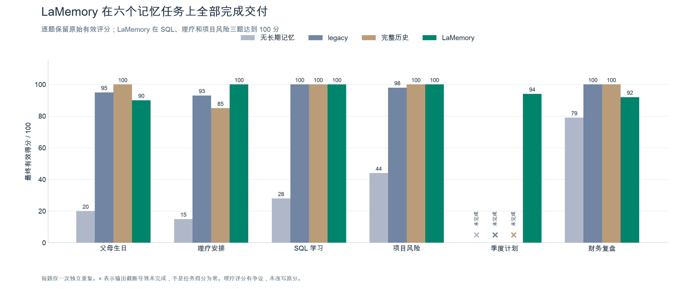
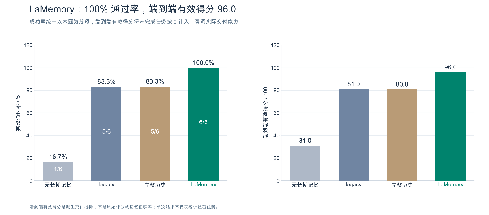
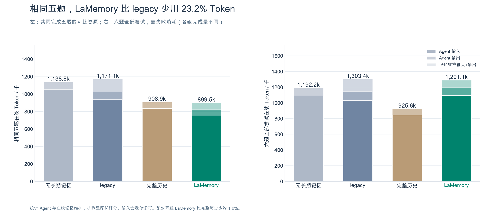
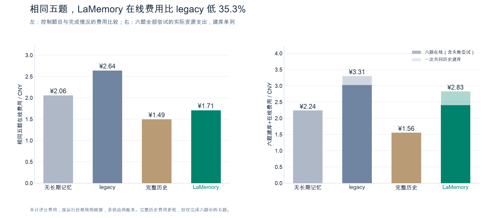
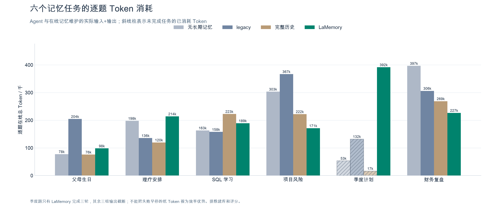
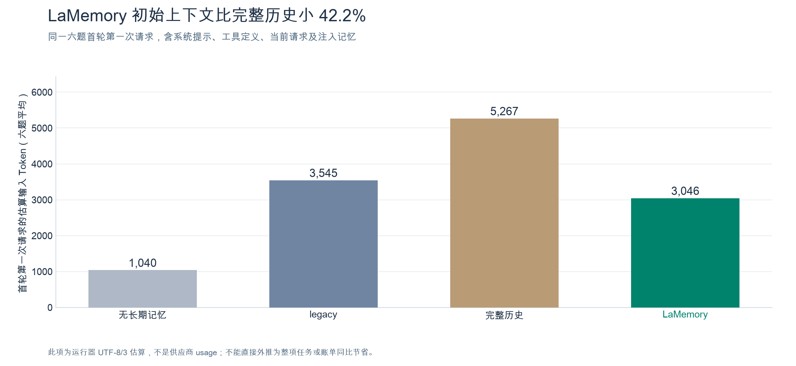

# LaMemory 六个记忆任务评测汇总

来源运行：`run-20261112-160947-805693`。仅纳入六个记忆任务，每题一次独立重复、三轮固定任务对话。

> LaMemory 是本轮唯一完成并通过全部六题的方法，最终有效均分为 96.0；在四组共同完成的五题上，在线 Token 比 legacy 少 23.2%，在线费用低 35.3%。这体现了当前样本下的交付完整性与相对旧系统的资源优势，不代表所有记忆质量或成本指标均最优。

## 1. 范围与共同条件

- 范围：父母生日、理疗安排、SQL 学习时间块、项目风险看板、季度学习计划、财务复盘。不纳入非记忆任务的得分、调用、Token、耗时或费用。
- 四组：none（无长期记忆）、legacy（完整注入提取后的 Markdown）、full_history（完整历史用户原文）、LaMemory（检索事实与分层摘要）。
- Agent/评分窗口 65536、输出上限 8192；每轮最多 8 次模型和 24 次工具调用；shared_strict 保留当前任务完整会话，超限明确失败。
- LaMemory 使用原请求 hybrid 检索，top-k=10、记忆预算 2048；主动记忆工具、静态 Skill、重排及 M3 自动学习关闭。
- 44 条共同历史记录一次建库，legacy 和 LaMemory 各成功提取 44 次；本轮没有再次出现来源校验建库失败。

## 2. 交付结果：LaMemory 六题全部通过



| 任务 | none | legacy | full_history | LaMemory |
|---|---:|---:|---:|---:|
| 父母生日 | 20 | 95 | 100 | 90 |
| 理疗安排 | 15 | 93 | 85 | 100 |
| SQL 学习 | 28 | 100 | 100 | 100 |
| 项目风险 | 44 | 98 | 100 | 100 |
| 季度计划 | 未完成（输出截断） | 未完成（输出截断） | 未完成（输出截断） | 94 |
| 财务复盘 | 79 | 100 | 100 | 92 |



| 方法 | 完整完成 | 达标通过 | 有效样本最终均分 | 端到端有效得分 |
|---|---:|---:|---:|---:|
| none | 5/6 | 1/6（16.7%） | 37.20（n=5） | 31.00 |
| legacy | 5/6 | 5/6（83.3%） | 97.20（n=5） | 81.00 |
| full_history | 5/6 | 5/6（83.3%） | 97.00（n=5） | 80.83 |
| lamemory | 6/6 | 6/6（100.0%） | 96.00（n=6） | 96.00 |

**口径：**完整完成要求三轮执行与评分均成功；通过还要求最终达到原 rubric 阈值。端到端有效得分＝六题最终有效分之和÷6，未完成按 0 计，是本汇总明确定义的交付指标；不改写原报告，不表示失败任务的记忆质量或已有产物得分为零。各组条件均分分母不同，不可直接据此排名。

LaMemory 在理疗、SQL、项目风险三题取得 100 分；季度计划 94 分，其他三组在此题因输出截断未完成。全六题相对 legacy 的通过率提升为 16.7 个百分点，端到端有效得分提升 15.0 分。无长期记忆组仅财务复盘达到总分阈值，不能将其 79 分解释为召回了历史事实。

## 3. 资源比较：相同题目与全部尝试分开

### 3.1 四组共同完成的五题

配对范围为生日、理疗、SQL、项目风险、财务五题。共同完成不等于共同达标；none 的多数题仍缺少历史事实。五题三轮全部执行完毕，用于避免季度题失败早停造成的资源分母差异。



| 方法 | 五题有效均分 | 在线输入 Token | 在线输出 Token | 在线总 Token | 在线费用/CNY |
|---|---:|---:|---:|---:|---:|
| none | 37.20 | 1,051,531 | 87,247 | 1,138,778 | 2.0559 |
| legacy | 97.20 | 1,072,142 | 98,991 | 1,171,133 | 2.6394 |
| full_history | 97.00 | 838,516 | 70,433 | 908,949 | 1.4944 |
| lamemory | 96.40 | 818,567 | 80,944 | 899,511 | 1.7086 |

LaMemory 相对 legacy：在线 Token 减少 **23.2%**，费用减少 **35.3%**；原评分均分 96.4 对 97.2，相差 -0.8 分。相对 full_history：Token 低约 1.0%，但费用高 **14.3%**。完整历史组本轮缓存利用、调用次数和零在线记忆维护费用共同影响账单，Token 与金额不能等同。

### 3.2 六题全部尝试的实际资源



| 方法 | 六题在线 Token（含失败） | 六题在线费用 | 一次建库费用 | 建库+六题在线 | 六题评分费用（另列） |
|---|---:|---:|---:|---:|---:|
| none | 1,192,205 | ¥2.2444 | ¥0.0000 | ¥2.2444 | ¥0.4475 |
| legacy | 1,303,367 | ¥3.0290 | ¥0.2784 | ¥3.3074 | ¥0.4497 |
| full_history | 925,591 | ¥1.5621 | ¥0.0000 | ¥1.5621 | ¥0.3177 |
| lamemory | 1,291,072 | ¥2.4069 | ¥0.4260 | ¥2.8329 | ¥0.4345 |

六题在线、一次共同建库与六题评分核算合计 **¥11.5962**。评分是评测开销，不纳入产品运行成本。建库是共同初始历史的独立支出，在此完整列出一次，没有分摊或重复累计。输入 Token 包含缓存读写；在线统计含 Agent、提取、摘要、查询及维护向量。费用按原运行价格快照与 provider usage 核算，不是供应商账单。

六题全部尝试的原始资源总量不可当作相同工作量的效率排名：LaMemory 实际完成了六题三轮，其他组只完成五题三轮。本报告同时展示配对五题与全部六题，避免借失败早停制造低成本优势。



逐题图使用相同的六题 online 统计；斜线表示未完成的尝试。季度题中只有 LaMemory 完成三轮，因此该题各柱代表的有效交付量不同，不适合直接比较效率。

### 3.3 初始上下文开销



该图对六题首轮第一次请求做平均，说明检索式注入能减少初始输入；属于 UTF-8/3 估算，含系统提示、工具和当前请求。它不等于整项任务累计 Token 节省：后续多次写文件与复查会重发大量会话和工具内容。

## 4. LaMemory 的优势与剩余缺口

### 已观察到的优势

1. **交付覆盖最完整：6/6 通过。** 本轮所有六题完成三轮，季度计划也完整交付。
2. **相对旧系统的资源效率。** 相同五题在线 Token 少约 23.2%、费用少约 35.3%，原评分接近。
3. **精确日程与任务约束可用于实际交付。** 理疗、SQL、项目风险最终均为 100 分；无长期记忆组在这些任务上明显落后。
4. **注入上下文较小。** 相比完整历史，首轮输入显著减少，为更长历史下的规模测试提供了值得继续验证的方向。

### 不能忽略的缺口

- 生日：明确的“父亲按摩仪尚未购买”已在记忆库中，却未进入该任务注入；召回了较早泛化购买计划，最终礼物仍标待确认，扣 10 分。
- 财务：30000 元明确基准已保存但未注入，概览仅有“3万出头”；未明确交付 37.5% 和 50000 元，扣 8 分。
- 季度：设计心理学、UI 沟通和研发协调的历史事实覆盖不足，另有计划算术与行动项的小问题；最终 94 分不能解释为全部事实均被覆盖。
- 完整历史组在本轮配对五题上的费用更低，条件评分略高。当前不能宣称 LaMemory 在所有质量或费用指标上全面胜出。

## 5. 评分复核与解释边界

**理疗题存在明显评分争议。** full_history 产物写“18:00 出发→40分钟路程→18:40到达→19:00开始”；评分器却因到达后只有20分钟额外缓冲而扣了15分，与 rubric 给出的18:00至18:40通勤预留示例不一致。主表与所有图均保留原评分，未利用该争议更改原始证据。

仅作敏感性分析：若只将该项恢复15分，full_history 配对五题均分由97.0变为100.0，六题端到端有效得分由80.83变为83.33，仍为5/6通过；LaMemory的6/6覆盖与资源统计不受此调整影响。这说明 LaMemory 的全题覆盖优势比小幅平均分差更值得强调。

- none、legacy、full_history 的季度失败均为输出达到8192的截断，不能据此断言其记忆召回一定错误。
- 每题仅一次独立重复，三轮复查不是三个独立样本；未建立统计显著性，也不能推导更大历史规模的收益。
- 六题仍是开发任务；manual facts 改写没有在本次启用，本次使用原请求查询。评分变化、任务生成与记忆检索的作用应分开。

## 6. 证据与复现

- [原始运行报告](../../.myclaude/benchmarks/run-20261112-160947-805693/report.json)、[逐请求用量](../../.myclaude/benchmarks/run-20261112-160947-805693/usage.jsonl)。原始文件未修改。
- [筛选数据与来源 SHA-256](comparison-data.json)、[方法级 CSV](metrics.csv)、[逐题 CSV](scores.csv)。
- `figures/` 同时提供 PNG 与 SVG，可直接用于汇报；绿色突出 LaMemory，所有坐标从0开始，并公开失败及分母。
- 绘图依赖 matplotlib；不调用模型或网络，不写记忆库。

```bash
MPLCONFIGDIR=/tmp/lamemory-mpl-cache .venv/bin/python -m benchmarks.memory_benchmark.plot_memory_results \
  --run .myclaude/benchmarks/run-20261112-160947-805693 \
  --output docs/lamemory-memory-task-results-20261112
```
