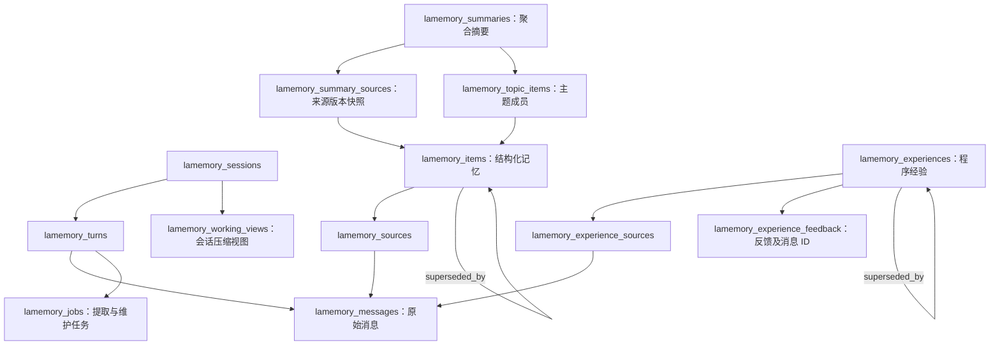
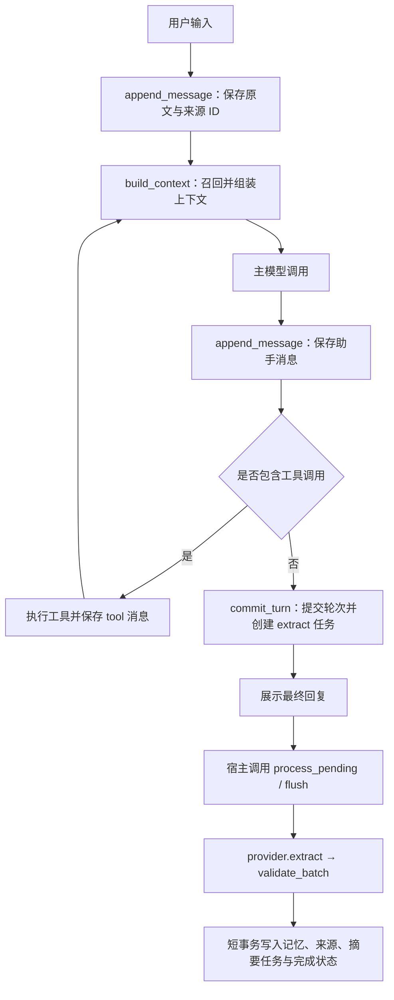

# LaMemory 存储结构与记忆生命周期

本文根据 **2026-11-10 当前仓库代码**整理，介绍 Layered Aggregated Memory（LaMemory）实际如何存储数据，以及记忆生成、更新、召回的调用链路。设计规划见 [架构与实施方案](lamemory-design.md)，运行与维护命令见 [使用与验证](lamemory-usage.md)。

## 1. 当前实现概览

LaMemory 以 **SQLite 为持久化存储，以原始消息为证据，以结构化记忆为主要检索对象**，在此基础上维护跨会话摘要与经过反馈验证的程序经验。

| 数据层 | 内容 | 当前用途 |
|---|---|---|
| 原始证据 | 用户、助手、工具消息及其轮次关系 | 恢复会话、追溯来源、重新处理任务 |
| 结构化记忆 | 事实 `fact`、偏好 `preference`、事件 `event` | 按范围召回、更正、遗忘和版本追踪 |
| 聚合摘要 | 用户概览 `profile`、项目/手动主题 `topic` | 跨会话背景、主题导航与有限长度概括 |
| 程序经验 | 任务类型、适用条件、操作步骤、结果依据和反馈 | 验证后复用任务做法 |
| 会话工作视图 | 当前会话旧轮次的压缩摘要 | 减少模型输入中的历史体积 |

这些层不是把一条记录依次搬到不同表。原始证据保留，结构化记录引用原始消息，聚合摘要引用结构化记录；程序经验另行引用任务轨迹。会话工作摘要与跨会话聚合摘要也分别维护。

当前只支持 **`keyword` 关键词检索**。没有 embedding、向量数据库、向量索引、自动主题聚类或自动 Skill 生成；服务也不会自行启动后台 worker。

## 2. 数据落在哪里

默认路径由 [config.py](../core/lamemory/config.py) 根据项目文件位置解析，不依赖启动命令所在目录：

```text
<项目根目录>/
└── .myclaude/
    └── lamemory/
        ├── lamemory.sqlite3       # 主数据库
        ├── lamemory.sqlite3-wal   # WAL 模式运行时可能出现
        ├── lamemory.sqlite3-shm   # WAL 模式运行时可能出现
        └── backups/              # 显式导入旧数据时创建
            └── <batch_id>/
```

可通过 `LaMemoryConfig(database_path=...)` 或 CLI 的 `--database` 指定其他路径。SQLite 连接启用外键、WAL 和 5000 ms busy timeout。启动时按序应用 `001_initial.sql`、`002_hierarchy.sql`、`003_procedural.sql`，并在 `lamemory_migrations` 记录版本；迁移后检查外键一致性。

旧 `session.jsonl`、`MEMORY.md` 是兼容导入源，新运行时不继续向其追加长期记忆。`core/memory.py` 中的 `Memory` 是委托给 `LaMemoryService` 的兼容入口。

## 3. 数据表与关系

### 3.1 表清单

以下是 LaMemory 核心迁移定义的 16 张表，字段列只列出阅读链路所需的主要字段。

| 表 | 主要字段 | 职责 |
|---|---|---|
| `lamemory_sessions` | `user_id, session_id, created_at` | 用户的会话登记 |
| `lamemory_turns` | `user_id, session_id, turn_id, committed_at` | 一轮对话是否完整提交 |
| `lamemory_messages` | `message_id, user_id, session_id, turn_id, seq, role, payload_json` | 按会话顺序保存原始消息；JSON 保留工具调用等结构 |
| `lamemory_items` | `memory_id, scope_kind, scope_key, type, content, status, revision` 等 | 结构化事实、偏好、事件与替代关系 |
| `lamemory_sources` | `user_id, memory_id, message_id` | 记忆与原始消息的多对多来源关系 |
| `lamemory_jobs` | `job_id, kind, idempotency_key, status, attempts, available_at, last_error, payload_json` 等 | 持久化提取/摘要任务、退避和错误 |
| `lamemory_suppressions` | `user_id, scope_kind, scope_key, source_key, slot_key, content_hash` | 遗忘后的重提取抑制 |
| `lamemory_working_views` | `user_id, session_id, through_seq, summary` | 当前会话压缩视图，每个会话一条 |
| `lamemory_summaries` | `summary_id, user_id, kind, topic_key, project_id, content, revision, generation, dirty, source_signature` | 用户概览和主题摘要当前版本 |
| `lamemory_summary_sources` | `user_id, summary_id, memory_id, source_revision, source_hash` | 摘要实际使用的来源快照 |
| `lamemory_topic_items` | `user_id, summary_id, memory_id` | 手动主题成员关系，与摘要生成来源分开 |
| `lamemory_experiences` | `experience_id, task_type, conditions, steps_json, result_basis, status, lineage_id` 等 | 程序经验、训练轨迹、反馈计数及版本 |
| `lamemory_experience_sources` | `user_id, experience_id, message_id` | 经验的原始任务消息来源 |
| `lamemory_experience_feedback` | `feedback_id, experience_id, lineage_id, trajectory_key, outcome, evidence_kind, evidence, source_ids_json` 等 | 独立任务反馈及证据 |
| `lamemory_imports` | `user_id, session_id, batch_id, manifest_json` | 旧数据导入清单和批次幂等记录 |
| `lamemory_migrations` | `version, applied_at` | 数据库迁移版本 |

Schema 原文见 [001 初始表](../core/lamemory/migrations/001_initial.sql)、[002 分层摘要](../core/lamemory/migrations/002_hierarchy.sql)、[003 程序经验](../core/lamemory/migrations/003_procedural.sql)。`002` 已将 `lamemory_items.scope_kind` 扩展为 `user/session/project`，不能仅根据 `001` 判断当前范围。

### 3.2 核心关系图



图中箭头表达数据关联；反馈的来源 ID 存在 `source_ids_json` 中，不是单独的消息外键关系。

### 3.3 一条结构化记忆长什么样

`lamemory_items` 的逻辑记录示例（ID 与时间均为示意）：

```json
{
  "memory_id": "lam_example",
  "user_id": "local-user",
  "scope_kind": "project",
  "scope_key": "atlas",
  "type": "fact",
  "content": "Atlas 使用 uv 管理依赖",
  "content_hash": "<规范化内容的 SHA-256>",
  "slot_key": "atlas.package_manager",
  "occurred_at": null,
  "status": "active",
  "revision": 1,
  "superseded_by": null,
  "origin": "explicit",
  "created_at": "2026-11-10T00:00:00+00:00",
  "updated_at": "2026-11-10T00:00:00+00:00"
}
```

来源 ID 存在 `lamemory_sources`，服务转成 `MemoryItem` 时附加 `source_message_ids`。`inspect(memory_id)` 进一步返回来源原文和版本链。

- `content_hash`：内容经过 NFKC、大小写折叠和空白规范化后计算，用于精确去重，不代表语义相似度。
- `slot_key`：可更新事实的位置，例如“项目包管理器”；只有具有相同 slot 的相关记录才会进入该冲突判断。
- `occurred_at`：事件发生时间。未知保持 `null`，不使用写入时间代替。
- `origin`：`explicit`、`extracted` 或 `legacy_import`。
- `revision` / `superseded_by`：更正后生成新 ID、新版本，旧记录指向替代者。

聚合摘要采用不同的版本方式：`lamemory_summaries` 保存当前内容并增加 `revision`，不另外保存每次摘要正文的历史表；结构化记忆的旧记录则会保留。

### 3.4 用户、会话、项目范围

`LaMemoryService` 创建时绑定可信的 `user_id`、`session_id` 和可选 `project_id`。身份不是由抽取模型决定的。

| `scope_kind` | `scope_key` | 可见范围 |
|---|---|---|
| `user` | 当前 `user_id` | 同一用户的不同会话共享 |
| `session` | 当前 `session_id` | 当前用户的指定会话 |
| `project` | 配置的 `project_id` | 当前用户、绑定相同项目的会话 |

按 ID 查看、更正、遗忘也检查可见性。程序经验只支持 `user/project`；工作摘要只属于对应会话。用户概览可能包含其他项目/主题的名称导航，但不因此载入其他项目的事实正文。

## 4. 记忆生成链路

### 4.1 自动提取：先保存完整对话，再消费任务



关键步骤对应 [service.py](../core/lamemory/service.py)：

1. **原文留档**：`append_message()` 生成 `msg_...`；用户消息通常开启新的 `turn_...`。`seq` 是当前会话内递增序号，原始消息保存为 JSON。
2. **提交轮次**：`commit_turn()` 校验以用户消息开始、以无工具调用的助手回复结束，并且工具调用与结果成对完整。提交标记与 `extract` 任务在同一事务写入。
3. **任务幂等**：事实提取键为 `extract:<session_id>:<turn_id>`，同一用户重复提交返回原任务。完成轮次后不能继续向该轮追加消息。
4. **调用抽取模型**：`process_pending()` 从数据库取该轮原文，调用 provider。默认 `ChatMemoryProvider.extract()` 实际只向抽取模型发送本轮用户消息及其 ID，不发送助手推测、思考和工具回显。
5. **验证整批候选**：默认最多 8 条，每条内容最多 4000 字符；检查类型、范围、slot、时间、字段集合和来源。自动事实提取必须引用本轮用户消息，不能指定用户身份、状态或版本。
6. **原子落库**：整批校验后，通过 `_save()` 写记忆及来源，并投递已有脏摘要的重建任务，最后把提取 job 标为 `completed`。批量事实写入失败会整体回滚；模型调用不占用数据库写事务。

`LaMemoryService(provider=None)` 不默认接外部模型，消费事实提取任务时会留下错误。兼容 `Memory` 默认注入 `ChatMemoryProvider`。默认抽取提示词要求 `user/session`，校验器也支持已配置项目的 `project` 候选；配置了项目不代表默认事实抽取会自动把所有内容归为项目记忆。

**任务消费由宿主安排**：终端 `OutputNode` 和正常 Web 对话在回复可见后，默认至多消费一个任务；`ChatRunner.send()` 自身只提交任务。即使 `auto_process_jobs=True`，直接使用服务也不会自动运行 worker。一个任务可能是旧提取或摘要任务，因此展示回复不等于本轮所有记忆已完成生成。

### 4.2 显式保存：工具调用内立即持久化

```text
用户要求“记住……”
  → 主模型调用 lamemory_store(content, scope_kind)
  → 工具绑定当前轮用户消息为来源
  → service.store() → 校验 → _save() → 提交事务
  → 返回状态、memory_id 和来源
```

主动工具定义见 [tools.py](../core/lamemory/tools.py)。模型不能通过工具参数选择其他用户或伪造来源。当前 `lamemory_store` 暴露内容和范围，类型使用 `store()` 默认的 `fact`；宿主 Python API 还能显式传入 `type`、`slot_key`、`occurred_at` 等字段。

| 返回状态 | 含义 |
|---|---|
| `saved` | 新记录已持久化并生效 |
| `duplicate` | 复用已有有效记录，补充来源 |
| `conflict` | 记录为 `pending` 待裁决，不进入默认召回 |
| `suppressed` | 命中遗忘/历史重放抑制，没有重新保存 |

轮次结束仍会创建自动提取任务；若自动候选与本轮显式保存的内容、范围相同且来源重叠，会复用记录，即使提取类型不同也避免重复新增。

### 4.3 聚合摘要如何生成

[hierarchy.py](../core/lamemory/hierarchy.py) 管理跨会话摘要：

```text
refresh_summaries() / consolidate() / define_topic()
  → 建立摘要定义，dirty=1
  → 创建 summary:<summary_id>:<generation> 任务
  → 读取有效来源快照
  → 模型摘要，或离线原文摘录
  → 发布前复核 generation 和 source_signature
  → 更新正文、revision、来源版本快照，dirty=0
```

- `refresh_summaries()` 首次建立固定 `profile`；配置项目时还建立 `project:<project_id>` 主题。普通启动和事实写入不会自动建立这些定义。
- `profile` 取有效的用户级 `fact/preference`，加项目/主题导航，不包含事件和 session 临时要求。
- 项目主题包含该项目有效记录；手动主题通过 `lamemory_topic_items` 指定成员。项目主题也可显式纳入允许的用户级记录。
- 有 `summarize_hierarchy` provider 时调用模型；否则采用原文拼接摘录。默认长度上限 1200 字符。
- 生成失败保留旧正文用于检查，但 `dirty=1` 时不召回。来源在生成期间改变时拒绝发布过期结果。

### 4.4 程序经验如何生成和晋升

[procedural.py](../core/lamemory/procedural.py) 走独立链路：

```text
已完成任务轨迹
  → capture_experience()，或开启 auto_learn_experiences
  → experience 任务 → provider.extract_experiences()
  → 保存 candidate 及来源
  → 可信宿主提交用户/测试反馈
  → 达到证据门槛 → active → 可以召回
```

也可由宿主使用 `propose_experience()` 直接创建候选。来源须属于当前会话中的同一个已完成轮次；候选包含 `task_type`、`conditions`、`steps`、`result_basis` 和来源 ID。自动候选在绑定项目时属于该项目。自动学习默认关闭，开启使用 `auto_learn_experiences=True` 或终端 `--learn-experiences`。

默认需要 **两个独立任务的用户/测试成功证据**，或用户明确认可，才能晋升为 `active`。独立轨迹用 `(session_id, turn_id)` 标识；训练轨迹不计独立成功，同一版本链同一反馈轨迹只记一次。模型自评只留档，不增加成功/失败计数。反馈含义由可信宿主提交，服务不自行把助手的一句“成功”解释成实际执行证据。

模型工具提供经验搜索、查看和撤销，不开放提交成功测试证据或用户认可的权限。

## 5. 记忆更新与失效链路

### 5.1 精确去重、冲突和更正

普通写入在同一用户、范围、类型的 `active/pending` 记录中比较规范化内容哈希与发生时间。重复时复用记录并合并来源。未知发生时间的事件还要求来源重叠，避免把不同任务中的同类事件误合并。

同一 `slot_key` 的非事件记录发生冲突时：

```text
普通 store / 自动候选，correction=False
  → 新项 pending，旧项 active，默认仍召回旧项

store(..., correction=True)，且 slot 只有一个当前冲突项
或 update(active_memory_id, 新内容, 更正来源)
  → 同一事务插入新项：active，revision=旧值+1
  → 旧项：superseded，superseded_by=新 ID
  → 清除工作摘要，标脏相关聚合摘要并排队重建
```

`update()` 继承旧记录的类型、范围、slot 和发生时间，新版本关联本次传入的更正来源；旧来源留在旧记录上，通过版本链可追溯。当前不允许直接 `update(pending_id)`，需要操作当前有效记录，或先忘记待裁决项。没有 slot 的普通写入不会进行通用语义冲突识别；复杂语义合并尚未实现。

`consolidate()` 可做精确整理：按用户、范围、类型、内容哈希、slot、时间合并重复有效项，合并来源并把重复项保留为 `superseded`；跳过未知时间事件，不自动判断事实过期或裁决语义冲突。

### 5.2 遗忘及防重新提取

```text
lamemory_forget(memory_id) → forget()
  → 当前指定记录及其前驱版本标记 deleted
  → 按范围保存内容哈希、slot、旧来源的抑制记录
  → 清除该用户的会话工作摘要
  → 相关聚合摘要标脏并排队重建
  → 后续自动提取旧内容/旧 slot/旧来源时返回 suppressed
```

显式重新保存可以解除匹配抑制，但有来源时必须是晚于抑制时间的新消息；重放旧的显式工具调用同样不能恢复。可信宿主也允许无来源显式保存。来源抑制采用保守规则，同一旧消息里的其他事实也可能被抑制。

**遗忘不是物理删除原文**：原始对话仍可用于会话历史和审计。该接口处理结构化记忆及相关摘要，不自动删除独立程序经验；经验停用使用 `revoke_experience()`。因此不能把它解释成“所有历史数据与派生内容已清除”。

### 5.3 聚合摘要的一致性

数据库触发器在记忆新增、更新和来源补充时使相关摘要 `dirty=1`，并增加 `generation`；服务在对应写事务中排队重建。更正时，手动主题成员关系会跟随替代版本。

召回摘要不仅要求 `dirty=0`，还会重新计算来源签名并与 `source_signature` 比较。失效期间可继续使用有效结构化记录，但不会注入旧摘要。`revision` 表示已发布摘要版本，`generation` 表示来源变化后的重建代次，两者作用不同。

### 5.4 经验撤销与替代

用户/测试的 `failure` 反馈会使经验变为 `revoked`，模型自评不触发撤销。普通成功反馈不会自动恢复 revoked 经验；用户重新明确认可可以恢复。

`replace_experience()` 创建同一 `lineage_id` 下的新版本，旧版本变为 `superseded`，新版本从 `candidate` 开始且成功计数归零。旧来源和反馈保留，只有 `active` 版本参与召回。

## 6. 召回与上下文组装链路

### 6.1 检索入口与匹配方式

```text
当前用户请求
  ├─ search()             → 有效事实/偏好/事件
  ├─ search_summaries()   → 有效概览与匹配主题
  └─ search_experiences() → 已验证经验
             ↓
      build_context() 预算筛选
             ↓
系统提示 + 记忆参考数据 + 工作摘要 + 历史与当前轮次
             ↓
          主模型回答
```

结构化记忆检索见 [retrieval.py](../core/lamemory/retrieval.py) 和 `LaMemoryService.search()`：

1. 按 `user_id`、可见 `scope`、状态过滤，默认只取 `active`。可选过滤 `type`、`scope_kind`、`status`、`occurred_after/before`。
2. 规范化查询与内容：英文/数字按词，中文按连续双字片段；单个中文字符也支持匹配。
3. 在 Python 中比较候选内容的关键词集合，当前没有使用 SQLite FTS。
4. 分数为“命中词数 / 查询词数”；完整规范化查询是内容子串时额外加 1。之后按分数降序、revision 降序、ID 排序，默认 `top_k=5`。这是 keyword 默认路径；显式 hybrid 增加 cosine 与按种类 RRF，无时间衰减排序。
5. 返回 `SearchHit`，包含完整记忆、`score`、`reason`、实际 `mode`、可选 retrieval 诊断及来源 ID。空查询或无关键词交集返回空列表；同义改写不保证召回。

默认搜索不包含 pending、superseded、deleted；显式传 `status` 可查询相应状态，`inspect()` 可追溯版本。程序经验以任务类型、条件、步骤拼成文本，复用同一关键词排序；结果依据不会加入经验匹配文本。

摘要检索只考虑当前用户、当前可见项目、非空且有效的摘要。主题匹配 `topic_key + content`；用户概览作为背景导航可在没有关键词命中时返回，但仍受 top-k 和预算约束。

### 6.2 build_context() 实际选择什么

服务从历史中取**最近一条用户消息**作为查询，最多截取 `max_content_chars` 个字符。工具循环沿用该请求，不将工具输出作为新的事实检索查询。三类对象使用一次 retrieve，共享一次 query embedding。实例内仅缓存 64 条查询向量，不缓存最终排名或旧来源包；每次检索重读权威候选，在所有外部调用结束后统一复核。事务内 retrieval generation 与 SQLite data_version 都可观察，覆盖同连接索引发布、反馈、遗忘和跨连接变更。

[context.py](../core/lamemory/context.py) 的预算分为两层：

```text
总输入预算 = context_window - reserved_output - safety_margin
默认值     = 32768 - 4096 - 512 = 28160

记忆预算   = memory_token_budget，默认 2048
```

记忆预算先尝试装入匹配的 active 经验，再装主题摘要、用户概览，最后装结构化命中。各层共享预算，不是分别拥有 2048 tokens；一次 `search()` 命中也不等于最终被注入。

总输入仍超限时依次：移除末尾结构化命中 → 移除末尾聚合/经验层 → 删除较旧完整轮次 → 舍弃工作摘要 → 缩短工具结果视图。当前用户消息等不可裁剪内容仍超限则抛出 `BudgetError`。裁剪只影响本次请求，数据库原文不变，工具调用与结果关系保持完整。

召回内容序列化到系统消息的 `<lamemory_data>` 中，并明确声明为历史参考数据、不得改变工具权限、以当前用户要求为准。工作摘要则作为单独的参考消息加入。

`ContextResult.diagnostics` 给出最终注入的记忆、摘要、经验，以及预算、检索模式、命中理由、丢弃轮次数、工具视图裁剪次数和查询截断情况。Token 计数模式为 `utf8_estimate`，按 UTF-8 字节与 JSON 包装估算，不是实际模型 tokenizer 的精确值。

### 6.3 工作摘要不等于长期聚合摘要

`compress(keep_turns=2)` 由宿主显式调用，将旧的完整轮次交给 `provider.summarize()`，保存到当前会话 `lamemory_working_views`，记录覆盖到的 `through_seq`。后续上下文用该摘要替代已覆盖历史；新消息和最近轮次继续原样加入。

压缩失败保留原视图，不删除原文；结构化更正、遗忘及有去重变更的整理会清除已有工作视图，避免其继续携带旧事实。自动预算裁剪本身不会隐式调用摘要模型。

## 7. 任务、失败与可见性

`lamemory_jobs.kind` 当前有 `extract`、`summary`、`experience`，状态为 `pending/completed/failed`。失败记录 `last_error`，默认最多尝试 3 次，按 `retry_delay_seconds × 2^(attempt-1)` 退避；`retry_failed()` 对原任务复位，不换幂等键。

- `process_pending(max_jobs)` 有界串行消费当前会话任务以及该用户的摘要任务，不处理其他会话的事实/经验提取。
- 事实/经验任务记录原 `project_id`，必须使用原项目配置消费。
- `flush(timeout)` 等待调用时目标任务，并继续追踪消费过程中新增的用户级摘要任务；返回 `complete/failed/timeout` 与数量。它不会替其他会话清空全部事实/经验任务。
- 任务持久化，重启后可以继续消费；当前没有并发 claim、租约和多 worker 调度，不应让多个进程同时消费同库任务。
- 摘要定义未建立、经验学习未开启时，`flush complete` 不代表系统自动补齐了这些能力，只表示本次目标范围中的已排队任务完成。

## 8. 代码阅读入口与验证范围

| 阅读目标 | 文件与入口 |
|---|---|
| 对外服务与主要事务 | [service.py](../core/lamemory/service.py)：`LaMemoryService` |
| SQLite、迁移与原始消息 | [store.py](../core/lamemory/store.py)、[migrations/](../core/lamemory/migrations/) |
| 数据对象与默认值 | [models.py](../core/lamemory/models.py)、[config.py](../core/lamemory/config.py) |
| 抽取请求与字段校验 | [providers.py](../core/lamemory/providers.py)、[extraction.py](../core/lamemory/extraction.py) |
| 关键词召回与预算组装 | [retrieval.py](../core/lamemory/retrieval.py)、[context.py](../core/lamemory/context.py) |
| 分层摘要与精确整理 | [hierarchy.py](../core/lamemory/hierarchy.py)、[consolidation.py](../core/lamemory/consolidation.py) |
| 程序经验与反馈 | [procedural.py](../core/lamemory/procedural.py) |
| 主动工具与兼容入口 | [tools.py](../core/lamemory/tools.py)、[core/memory.py](../core/memory.py) |
| Agent / 终端 / Web 调用 | [runner.py](../Agent/chatBot_with_memory/runner.py)、[main.py](../Agent/chatBot_with_memory/main.py)、[web.py](../Agent/chatBot_with_memory/web.py) |

本文以代码实现为依据，没有读取真实记忆数据库，也不报告真实用户记忆的数量或内容。相关离线行为测试位于 [tests/lamemory/](../tests/lamemory/)，使用临时目录、临时数据库和可替换模型，可运行：

```bash
.venv/bin/python -m unittest discover -s tests/lamemory -p 'test_*.py'
```

本次文档核对时运行上述离线回归：**69 项全部通过**（2026-11-10）。其中 HTTP 测试需要绑定本机临时端口，沙箱限制下无法执行，获准在沙箱外重跑后通过。本次没有重新执行真实模型在线评测。

已有真实模型 smoke 的结果与限制见 [验证记录](../benchmarks/lamemory/README.md) 和 [M2/M3 交付说明](lamemory-m2-m3.md)。功能闭环验证不等于摘要质量或复杂任务经验迁移收益已经得到系统评估。

## 9. Hybrid 检索投影（schema v4）

迁移 `004_hybrid_retrieval.sql` 增加 retrieval_state、embedding_entities、embedding_spaces、embeddings、embedding_jobs、embedding_progress 六张 `lamemory_` 表。前三类权威对象变更在原事务内更新账本和用户代次，删除保留范围 tombstone；关系与投影变化也增加用户代次。投影只在相同空间、代次、实际输入 hash 和有效状态下使用，不成为事实来源。

`enqueue_embeddings/process_embedding_jobs/flush_embeddings` 管理独立持久化索引队列；provider 调用在写事务外，发布在短事务内 CAS 复核来源。failed 有限重试后保留，显式 retry；损坏或丢失投影可协调 repair。原 `flush()` 继续只处理生成任务，不隐式消费索引。配置、命令、覆盖率、降级与当前限制详见 [混合召回实施与验证](lamemory-hybrid-retrieval.md)。本节是新增实现；上文 69 项是文档核对时历史记录，本轮最终数量见新验证报告，真实向量 smoke 仍缺配置未执行。
